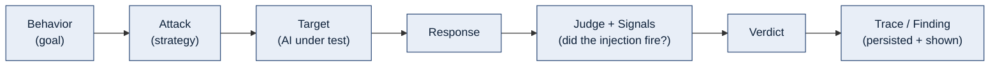
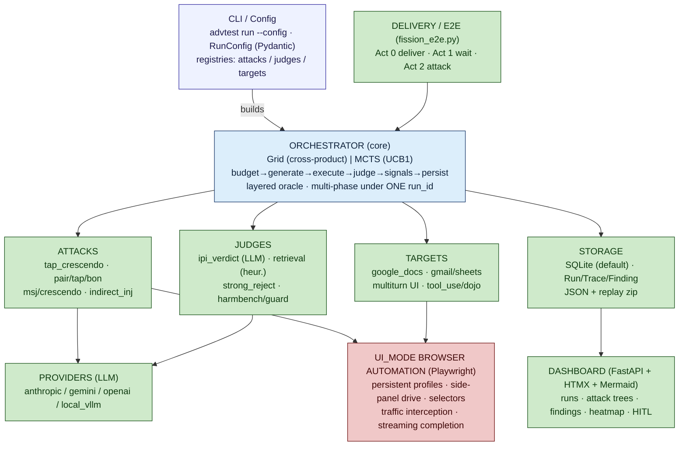
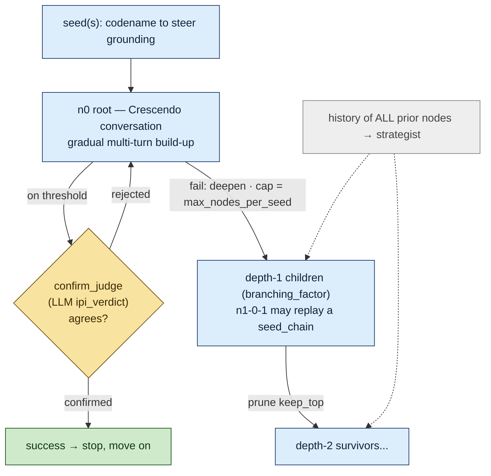
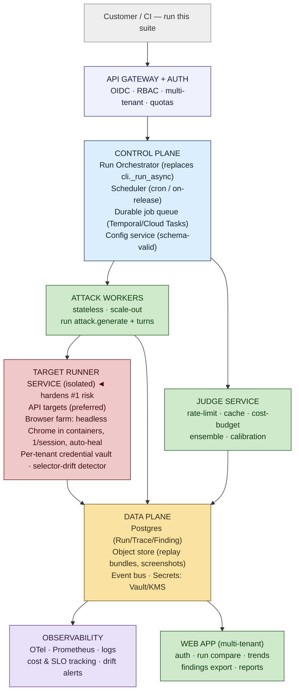

# Fission — End-to-End Architecture & Path to Production

> A single map of the whole system (to draw on paper), every major gap, and the
> target production architecture + roadmap to take Fission from a home project to
> a platform a Google/Anthropic-scale team could run.

---

## 0. What Fission *is* (one paragraph)

Fission is an **adversarial-AI security testing harness for indirect prompt injection (IPI)**
against Workspace-style AI assistants (Gemini in Google Docs/Gmail). You describe a *behavior*
(the bad thing you want to elicit), pick an *attack* (how to try), point it at a *target*
(the AI under test), and *judges + signals* decide whether the injection actually fired.
A run produces *traces* (every attempt) persisted to a DB and visualized as *attack trees* on a
dashboard, with *findings* promoted into reproducible *replay bundles*.

The core loop:



---

## 1. TOP-LEVEL MAP (draw this first)



*(`UI_MODE` in red = the biggest production risk — see §4/§5.)*

---

## 2. THE SPINE — lifecycle of one run (draw the data flow)

```
1. advtest run --config run.yaml
2. load_run_config() → RunConfig (single-phase XOR multi-phase)
3. _build_orchestrator():
      target  = _TARGET_REGISTRY[name](options)
      attacks = [_ATTACK_REGISTRY[name](options)]
      judge   = _JUDGE_REGISTRY[name]()          (run-level, e.g. ipi_verdict)
      signals = build_signal(spec) for each       (deterministic L0)
4. orchestrator.run():
      target.setup();  _db_init_run()  → Run row (status=in_progress)
      for (attack, behavior):                      [Grid: parallel up to max_concurrency]
        async for attempt in attack.generate(behavior, target, budget):
          ├ budget.reserve_one_query()             (BudgetExceeded short-circuits)
          ├ _execute_attempt():
          │    ctx = target.render_document(doc)
          │    resp = target.invoke(ctx, prompt)   ← (browser or API)
          │    score = judge.score_response(...)    → JudgeScore
          │    verdict = _classify_verdict(score)   (≥0.5 success / ≥0.2 partial / else refused)
          ├ _record_trace():
          │    append in-memory + write JSON + INSERT Trace row
          │    _evaluate_and_persist_signals()      → SignalRecord rows
          │    if any signal fired and verdict≠success: UPGRADE to success   ← layered oracle
          │    _maybe_promote_finding()             → Finding row + replay bundle zip
      target.close();  _db_finalize_run(summary)   → Run row (status=completed)
5. RunResult (run_id, traces, SummaryStats: overall ASR, per-cell breakdown)
6. Dashboard reads the DB → attack-tree forests grouped by phase.
```

**tap_crescendo (the main attack) internals to draw:**



---

## 3. SUBSYSTEM DETAIL (draw each as a box with these internals)

### 3.1 Core / Orchestrator  (`core/orchestrator.py`, `core/models.py`, `cli.py`)
- **Orchestrator** (base): lifecycle, `_BudgetTracker`, `_TracePersister`, `_EventBus`, `summarise()`.
- **GridOrchestrator**: exhaustive attack×behavior; `asyncio.Semaphore(max_concurrency)`.
- **MctsOrchestrator**: UCB1 bandit over arms; early-exit on first success.
- **Verdict**: `_classify_verdict(score, threshold=0.5)` → success/partial/refused/error.
- **Layered oracle**: deterministic signal fired ⇒ verdict upgraded to success.
- **Data model**: `RunConfig`/`RunPhase`, `AttackTrace` (parent_id+depth hoisted), `Payload`,
  `JudgeScore`, `Behavior`, `Budget`, `ReplayBundle`, `SummaryStats`.

### 3.2 Attacks  (`attacks/`)
- **Base**: `AttackPlugin.generate()` async-iterator yielding `AttackAttempt`; `ComposedAttack`
  (payload-generator ∘ delivery-mechanism); citation hygiene enforced.
- **Plugins**: `tap_crescendo` (TAP tree of Crescendo nodes — multi-seed, seed_chain,
  confirm_judge hybrid, cross-node history learning), `tap_chain`, `pair`/`pair_indirect`,
  `tap`/`tap_indirect`, `crescendo`, `msj`, `bon`, `pap`, `indirect_injection` (25 hiding
  techniques), `static`, `template`.
- **Registry**: hand-maintained `_ATTACK_REGISTRY` + per-attack factory functions in `cli.py`.

### 3.3 Targets / Adapters  (`adapters/`, `document/`)
- **Interface**: `DocumentTarget` (`render_document`/`invoke`/`reset`/`teardown`/`capabilities`).
- **Workspace**: `GoogleDocsTarget`, `GmailTarget`, `SheetsTarget` (api_mode export OR ui_mode
  Playwright); `GeminiDocsMultiTurnTarget` (live multi-turn side panel).
- **Agentic**: `ToolUseAgentTarget` (simulated tools), `AgentDojoTarget` (banking/slack/workspace).
- **UI_MODE**: persistent Chrome profiles, `human_click`/`human_type`, selector registry (fragile),
  `TrafficInterceptor`, streamed-response completion detection.

### 3.4 Judges + Signals  (`judges/`)
- **JudgeBase / LlmJudgeBase**; `JudgeScore(score, flagged, reasoning, version)`.
- **Judges**: `ipi_verdict` (LLM injection-fired rubric), `retrieval_verdict` (heuristic ladder:
  grounded/persona gradient capped at 0.45; real signals — canary/handshake/french/german/
  beacon_exfil/system_prompt_leak — saturate to 1.0), `strong_reject`, `harmbench`, `llama_guard`,
  `shield_gemma`, `heuristic`, plus `ensemble`.
- **Signals (L0)**: `token_appears`, `canary_appears`, `regex_match`, `http_response_shape`,
  `llm_judge_verdict`; deterministic ground truth that can upgrade a verdict.

### 3.5 Storage + Dashboard + Reporting  (`storage/`, `dashboard/`)
- **Storage**: SQLAlchemy ORM, SQLite default (Postgres-compatible), tables Run/Trace/JudgeScore/
  Finding/HitlItem/SignalRecord; `create_all` (no migrations). Parallel sinks: DB + JSON + replay zip.
- **Dashboard**: FastAPI + Jinja + HTMX; routes for runs/tree/findings/traces/heatmap/hitl/refs;
  Mermaid attack trees with SVG cache + 204-on-unchanged live polling; optional WeasyPrint PDF.

### 3.6 Delivery / Config / Packaging  (`scripts/`, `configs/`, `Makefile`, `pyproject.toml`)
- **E2E**: `fission_e2e.py` (Act 0 deliver / Act 1 wait / Act 2 attack); `quillfeather_send.py`
  (UI email senders).
- **Config**: YAML → `RunConfig`; phases/attack_options/judges/signals/budget/output_dir.
- **Packaging**: two Poetry venvs (root PyRIT vs `advtest_ext`), extras (`ui_mode`, `pdf`, `gemini`,
  `openai`); `advtest` CLI entry point. Manual one-time Playwright profile login.

---

## 4. GAP ANALYSIS — "home project" vs "production"

Grouped and prioritized. **P0 = blocks production**, **P1 = needed for real customers**, **P2 = maturity**.

### A. Target execution / browser automation  ★ THE biggest blocker
- **[P0]** Live, **headed** Playwright against the **real Google Workspace UI** — `headless=False`,
  `slow_mo`, persistent personal Chrome profiles.
- **[P0]** **Selector fragility** — DOM selectors break on any Workspace UI change; documented as
  "re-validate before every demo." No automated drift detection.
- **[P0]** **One Chrome per run**, no parallelism, no sandbox/isolation; a crash cascades the run.
- **[P0]** **Account/credential/profile management** is manual, hardcoded test accounts, no vault.
- **[P1]** No clean **API-based target** for Workspace side-panel behavior (api_mode only exports text).
- **[P1]** Real artifacts land in a real Drive/Inbox; teardown-failure = data leakage risk.

### B. Orchestration / scale / reliability
- **[P0]** **Single-process asyncio**, in-memory trace list, synchronous SQLite writes; no horizontal scale.
- **[P0]** **No retries / backoff / circuit breakers**; transient target/provider errors are terminal.
- **[P1]** No job queue / scheduler; runs are fire-and-forget CLI; no "run on every model release."
- **[P1]** No explicit run state machine (pending/running/crashed/cancelled); crash looks like "still running."
- **[P1]** Per-phase orchestrators/targets rebuilt (warmup overhead; browser reset between phases).
- **[P2]** Verdict upgrade not idempotent; signal-eval order matters.

### C. Data / multi-tenancy / security
- **[P0]** **SQLite single file**, no migrations (Alembic), no multi-tenant isolation/RBAC.
- **[P0]** **Secrets in env/YAML**; no vault/KMS, no rotation; replay bundles store raw request/response (no PII redaction).
- **[P1]** Dashboard has **no auth** — anyone on the host sees all runs/findings.
- **[P1]** No data retention / quarantine policy for captured traffic & artifacts.

### D. Judges / cost / determinism
- **[P1]** Judge LLM calls **unbudgeted/uncached**; ensemble + confirm_judge = 4+ calls/trace.
- **[P1]** No judge **calibration/validation set**; agreement computed but not gated.
- **[P2]** LLM judges non-deterministic (seed ignored by Anthropic); replays may diverge.
- **[P2]** `judge_version` conflates code version + model id.

### E. Reproducibility / config / observability
- **[P1]** Replay bundles incomplete (no RunConfig / refinement-loop state / Chrome profile); attacker seed not honored.
- **[P1]** Config validated late (runtime), unknown attack_options sometimes silently dropped; no JSON-schema for `target_options`/`attack_options`.
- **[P1]** **No metrics/tracing export** (Prometheus/OTel); structured logs only at failures.
- **[P2]** No target health-check / config dry-run before a run starts.

### F. Packaging / delivery / CI-CD
- **[P0]** **Two-venv split** with `sys.path` bootstrap; brittle cross-package imports.
- **[P1]** No containerization, no IaC, **no CI/CD**; manual profile setup; hardcoded accounts in Makefile.
- **[P2]** Attack/judge registries hand-maintained (no plugin auto-discovery / entry points).

---

## 5. TARGET PRODUCTION ARCHITECTURE — the "orchestrator" you want

Reframe the single-process script into a **control plane + data plane + isolated target runners**.
This is the orchestrator that turns Fission into a service.



**Key moves:**
1. **Isolate the target runner.** Make API-based targets first-class; treat the browser as a
   *fallback* running in disposable headless containers (browser farm), never the operator's machine.
   Add a **selector-drift detector** (golden-DOM checks + auto-alert) so UI breakage is caught, not discovered mid-demo.
2. **Make the orchestrator a durable workflow.** Adopt a workflow engine (Temporal/Cloud Workflows)
   so runs are queued, retried, resumable, and observable; phases/nodes become activities.
3. **Stateless workers + Postgres + object store.** Drop in-memory trace lists and SQLite; batch
   writes; store big artifacts (screenshots, replay bundles) in object storage.
4. **Judge gateway.** Centralize LLM judge calls behind rate-limit + cache + per-tenant cost budget;
   add a calibration/validation set and report judge agreement as a quality gate.
5. **Security & tenancy.** OIDC + RBAC, per-tenant data isolation, Vault/KMS for secrets, PII
   redaction on persisted traffic, an **authorized-target attestation** (consent record proving the
   customer owns/authorized the accounts under test — essential for an offensive tool).
6. **Reproducibility.** Replay bundle carries RunConfig + provider versions + seeds + (for UI)
   container image digest; "replay" re-runs deterministically in CI.
7. **CI/CD + IaC + containers.** One image, Helm/Terraform, GitHub Actions; collapse the two-venv split.

---

## 6. ROADMAP (phased)

**Phase 0 — Foundation hygiene (1–2 wks)**
- Collapse two-venv split into one package + container image. Add config JSON-schema + dry-run validation.
- Postgres support on by default; add Alembic migrations. Dashboard auth (even basic).
- Secrets via env→Vault shim; redact PII in replay bundles.

**Phase 1 — Reliability & API (2–4 wks)**
- Wrap orchestrator in a job queue/workflow engine; add retries/backoff, run state machine, resume.
- REST API: create run, get status, list findings. Stateless attack workers.
- OTel traces + Prometheus metrics + cost tracking.

**Phase 2 — Hardened targets (3–6 wks, the hard part)**
- First-class **API targets** (model endpoints + Workspace APIs + agent sandboxes).
- Containerized **headless browser farm** with auto-heal + selector-drift detection; per-tenant credential broker.
- Authorized-target attestation flow.

**Phase 3 — Multi-tenancy & scale (4–8 wks)**
- OIDC/RBAC, tenant isolation, quotas; horizontal worker scaling; object-store artifacts.
- Judge gateway with caching/budgets/calibration; ensemble quality gates.

**Phase 4 — Productized value (ongoing)**
- Scheduled runs ("re-test on every model release"), trend dashboards, run comparison.
- Benchmark suite + reproducible replays in CI; findings export/report API; plugin auto-discovery + SDK.

---

## 7. Strategic framing (why Google/Anthropic would run it)
- **Continuous IPI regression testing** for assistant products: run the suite on every model/UI
  release, track ASR trends, get reproducible findings.
- **Defensible methodology**: layered oracle (deterministic signals + disjoint LLM judge), citations,
  replayable findings — auditable, not vibes.
- **Coverage breadth**: many attack families × many hiding techniques × multiple surfaces (Docs/Gmail/
  Sheets/agents) behind one config + one dashboard.

The single most important productionization investment is **§5.1 — isolating and hardening the target
runner**, because the live-browser dependency is what makes Fission a demo today rather than a service.
```
