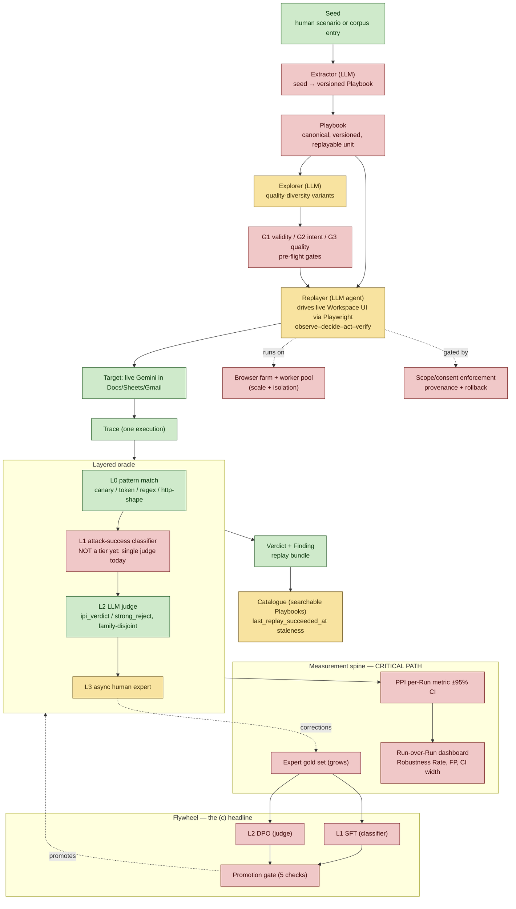
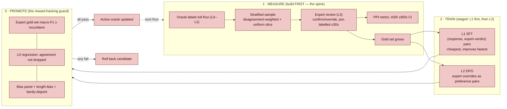

# Fission — Target (c) Build Map: what we're building, on what exists

> Goal (c): the **autonomous, self-improving** red-team platform — adaptive agent +
> measured oracle + Explorer + flywheel that keeps pace with Gemini on its own.
>
> This doc overlays the **target architecture** onto the **current codebase** so the
> gap is explicit. Build-status is a *first-draft read* from a code walkthrough —
> correct anything that's wrong; that's how we draw this together.

## Legend

- 🟩 **BUILT** — exists and works today (verified in code / §7 of the report).
- 🟨 **PARTIAL** — a version exists but is short of what (c) needs.
- 🟥 **TO BUILD** — does not exist yet; new work for (c).

---

## 1. End-to-end (c) pipeline — with build status

---

## 2. The flywheel (deep-dive) — measure → train → promote

**Why this order:** you cannot claim improvement you cannot measure, so the **measurement
spine is built first**. Then close the loop on **L1 only** (cheap, direct signal, fast to move)
and prove it; expand to L2; train the agentic roles (Explorer/Extractor/Replayer) *last*,
because those change attack behavior and are the riskiest to auto-train.

**The proof experiment (what convinces a Google reviewer):**
over K rounds of expert corrections, **L1 agreement with experts goes UP** while **L0
agreement does NOT drop** (the frozen, model-independent audit catches reward-hacking).
One number, one CI, one ablation vs the frozen baseline. Run it on L1 before committing the
full architecture — the entire (c) thesis rests on this loop actually closing within a
realistic label budget.

---

## 3. Current → target mapping (what exists, what it becomes, the gap)

| Report component | Current code (this session's read) | Status | Gap for (c) |
|---|---|---|---|
| **Seed** | hand-written YAML configs; behaviors catalogue | 🟩/🟨 | corpus-entry ingestion not automated |
| **Extractor** (seed→Playbook) | none — configs authored by hand | 🟥 | LLM that compiles seed/corpus into a versioned Playbook |
| **Playbook** (canonical unit) | `RunConfig` + attack options (not a first-class versioned object) | 🟥 | the Playbook schema + auto-commit + provenance |
| **Explorer** (QD variants) | `tap_crescendo` strategist + seeds + history learning | 🟨 | formal mutation_surface, MAP-Elites coverage, G1/G2/G3 |
| **Intent Verifier (G2)** | `confirm_judge` confirms *success*, not intent-preservation of variants | 🟥 | binary "same effect, same mechanism?" gate before browser run |
| **Replayer** (UI agent) | VERIFIED: `_run_side_panel_flow` is a SCRIPTED sequence (open→reset→submit→read→screenshot) + reactive drift recovery; conversational decisions come from `tap_crescendo`, not per-UI-step | 🟨 | action-level observe–decide–act–verify agent (DOM→choose action) |
| **Target** (live Gemini UI) | Docs/Sheets/Gmail browser automation works (§7 findings) | 🟩 | — |
| **L0 pattern match** | signals: token/canary/regex/http-shape | 🟩 | — |
| **L1 attack-success classifier** | VERIFIED: orchestrator uses a SINGLE judge; harmbench/llama_guard are registry options only; nothing trained; no tiering | 🟥 | wire as a distinct classifier-mode tier + make it SFT-trainable |
| **L2 LLM judge** | `ipi_verdict`, `strong_reject`, family-disjoint — but single judge in default path; `ensemble.py` exists yet DORMANT | 🟩 | make it DPO-trainable + log full rubric for audit |
| **L3 async human** | VERIFIED: `HitlItem` + `enqueue_hitl` + `/hitl` route + ensemble disagreement→enqueue ALL exist, but fire only under the (unused) ensemble path; no correction→gold-set/retrain loop | 🟨 | activate enqueue in default path + correction→gold-set flow |
| **Measurement spine (PPI)** | none (§7: subsample not collected) | 🟥 | **critical path** — metric + gold set + trend dashboard |
| **Flywheel (train/promote)** | none | 🟥 | SFT/DPO loops + promotion gate (Table 2) |
| **Catalogue** | runs/traces/findings in DB + dashboard | 🟨 | searchable Playbook catalogue + staleness stamping |
| **Browser farm / scale** | one Chrome per run, headed | 🟥 | headless container pool + per-session isolation |
| **Governance** (scope/consent/rollback) | none explicit | 🟥 | scope gate, decision provenance, promotion rollback, kill-switch |

---

## 3a. Verified corrections (code walkthrough)

- **Replayer is scripted, not an action-level agent.** Decisions are conversational (in `tap_crescendo`), not per-UI-step. The "agent driving Playwright by observing the DOM" is the gap.
- **The oracle is "signals + ONE judge + verdict-upgrade."** No L0/L1/L2/L3 tiers in the running path. `ensemble.py` (multi-judge + HITL routing) exists but is **dormant**.
- **L1 does not exist as a trained tier**; harmbench/llama_guard are unused registry options.
- **HITL plumbing exists but is switched off and open-loop**: queue + enqueue + review route are there, but only the dormant ensemble enqueues, and **no correction feeds a gold set or retraining**.
- **Good news for the flywheel:** the enqueue scaffold means the spine is *activate-and-extend*, not from-scratch — turn on enqueue, add a gold-set sink, PPI metric, and the training loops.

## 4. Headline read

- **What's solid today:** the *adaptive agent against the live product* (Replayer + drift
  recovery + real §7 findings) and *half the oracle* (L0 + L2). These are the hard,
  differentiated parts — and they're real.
- **What (c) hinges on and doesn't exist yet:** the **measurement spine** and the
  **flywheel**. This is the headline for (c) *and* the biggest gap. Build measurement first,
  prove the L1 loop closes, then expand.
- **What scales/guards it:** browser farm + governance — needed for autonomous operation,
  but downstream of proving the loop works.
