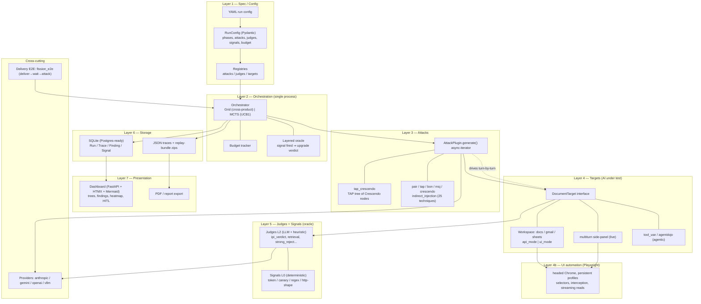
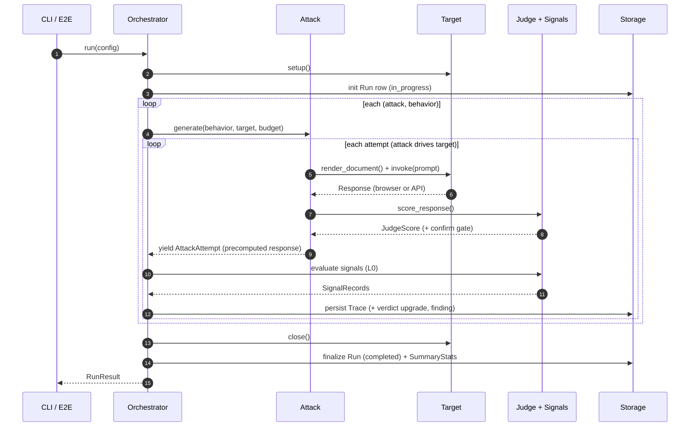
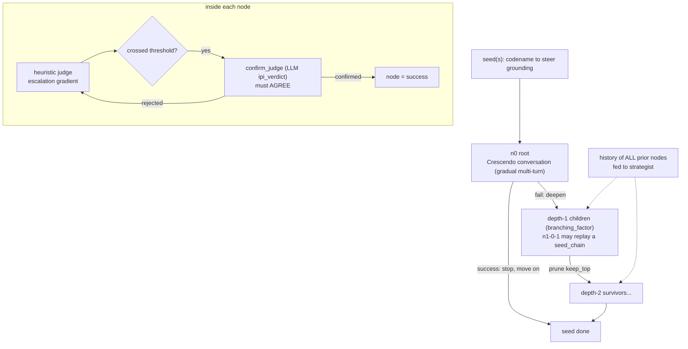
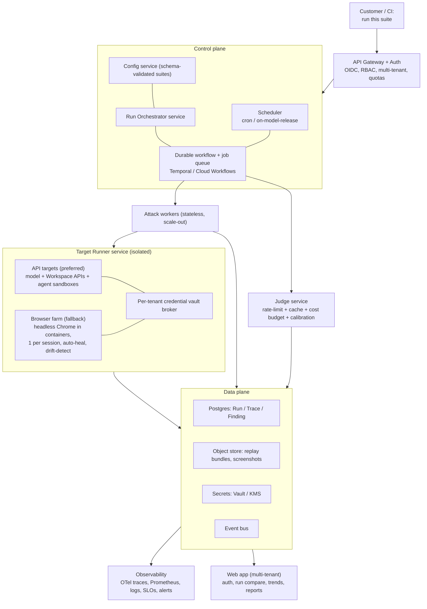

# Fission — Architecture Diagrams (detailed)

Mermaid diagrams (render on the dashboard or any Mermaid viewer). Four views:
1. Layered architecture (the boxes)
2. Run lifecycle (the data flow / spine)
3. `tap_crescendo` search (the core attack)
4. Target production architecture (the proposed control plane)

Each layer is annotated with its **role**, **current choice**, and the **key fork** we
brainstorm in `FISSION_ARCHITECTURE_AND_PRODUCTION.md` §4–5.

---

## 1. Layered architecture (current)

---

## 2. Run lifecycle (the spine)

---

## 3. tap_crescendo search (core attack)

---

## 4. Target production architecture (proposed control plane)

---

## Layer index (what each is, current choice, key fork)

| # | Layer | Current choice | Key fork to decide |
|---|-------|----------------|--------------------|
| 1 | Spec / Config | YAML → Pydantic `RunConfig`, string registries | one-shot "run" vs first-class versioned **suite/target/schedule** objects |
| 2 | Orchestration | single-process asyncio, Grid/MCTS, in-memory | keep clean engine + wrap in **durable workflow** vs distributed rewrite |
| 3 | Attacks | plugins, async-iterator that **drives** the target | attacks as **drivers** (hold session) vs **planners** (emit attempts) |
| 4 | Targets | live **headed browser** vs api_mode export | **fidelity (browser farm)** vs **scale (API targets)** — or both tiers |
| 5 | Judges/Oracle | signals L0 + LLM judge L2 + confirm gate | how much to trust LLM judge; build a **calibration set** |
| 6 | Storage | SQLite + JSON + zips, no migrations | Postgres + object store + Alembic (low controversy) |
| 7 | Presentation | FastAPI + HTMX, single-user | add auth + multi-tenancy + trends; server-render is fine |
| X | Delivery/Pkg | UI email senders, 2 venvs, manual profiles | controlled **test-tenant fixtures** vs UI senders; one container |
