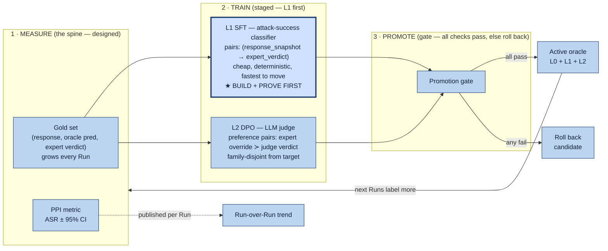
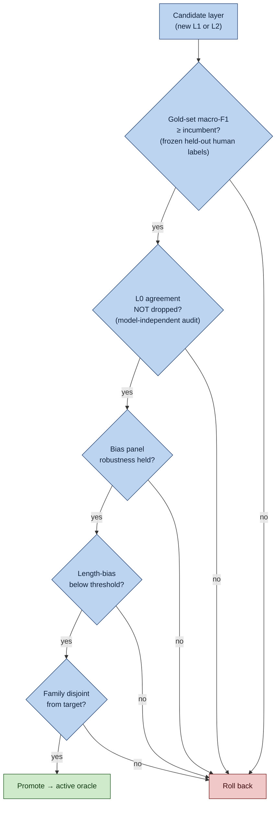

# Fission — The Flywheel (detailed design)

> The (c) headline: the oracle (and later the agents) **improve themselves** from expert
> corrections, staying calibrated as Gemini / the UI / the attacker surface drift. It
> consumes the **gold set** the [measurement spine](FISSION_MEASUREMENT_SPINE.md) produces.
>
> **Everything here is 🟦 ADD (none built).** It is also the riskiest part — so it is
> **staged**: prove the loop closes on the cheapest layer (L1) before building the rest.

## The loop: measure → train → promote → (active oracle) → measure

---

## The promotion gate — the anti-reward-hacking guard

A trained candidate replaces the incumbent **only if it passes every check**. Any failure
rolls it back automatically.

**The key idea — L0 is a frozen, model-independent audit.** The trained layers (L1, L2)
**never see L0's pattern-matched signals during training**. So if a tuned model starts
reward-hacking (gaming the gold set, drifting away from ground truth), its agreement with
L0's deterministic signals (canary present? handshake echoed? beacon URL emitted?) drops —
and check K2 catches it and rolls it back. L0 can't be gamed because it isn't trained.

---

## What trains on what

| Layer | Method | Training signal (from gold set) | Why it's ordered here |
|---|---|---|---|
| **L1 classifier** | SFT | `(response_snapshot → expert_verdict)` pairs | cheapest, direct, deterministic, **fastest to show movement** → prove the loop here first |
| **L2 LLM judge** | DPO | expert **overrides** of the incumbent judge = preference pairs (expert-correct ≻ judge-wrong) | higher value, more delicate; do after L1 proven |
| **Agentic roles** (Extractor / Explorer / Replayer / Intent-Verifier) | prompt + policy updates | triage failures, gate rejections, operator inventory | changes *attack behavior* — riskiest; **last**, and keep prompt-versioned not auto-trained until much later |

---

## Staged build order (do NOT build all at once)

1. **Spine** (gold set + PPI + trend) — prerequisite.
2. **L1 SFT loop + promotion gate** → run the **proof experiment**.
3. **L2 DPO loop**.
4. **Agentic-role tuning** — only once 1–3 are stable.

### The proof experiment (what validates the entire (c) thesis)
> Over K rounds of expert corrections: **L1's macro-F1 vs the expert gold set goes UP**,
> while **L1's agreement with L0 does NOT drop** (no reward-hacking), and L1 **beats the
> frozen pretrained baseline** (ablation). One number, one CI, one ablation — on the
> cheapest layer — *before* committing to L2/agentic. If it closes, (c) is fundable. If it
> doesn't, you learned it cheaply and fall back to (b) without over-building.

---

## Safety / governance (mandatory for an autonomous self-improving offensive system)

- **Provenance:** every promotion logged — which gold labels, which checks, which model
  version became active, when. A Finding can always be traced to the oracle version that scored it.
- **Reversible:** promotion gate gives automatic rollback; add a manual **kill-switch** to
  freeze the active oracle at a known-good version.
- **Bounded autonomy:** the loop tunes *evaluation* (L1/L2) freely; tuning the *attacker*
  (agentic roles) stays gated + logged because it makes the system better at attacking.
- **Label integrity:** gold labels are immutable (`frozen`); retraining reads, never edits.

The flywheel closes the loop the spine opens: spine **measures + collects**, flywheel
**trains + promotes**, the improved oracle scores the next Run, which feeds the spine again.
