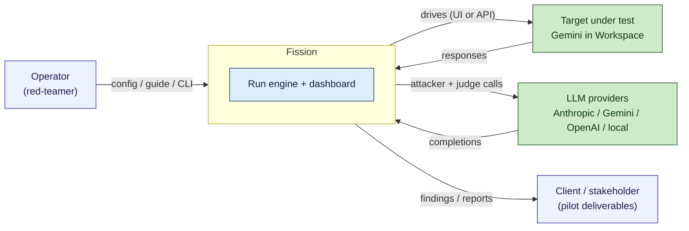
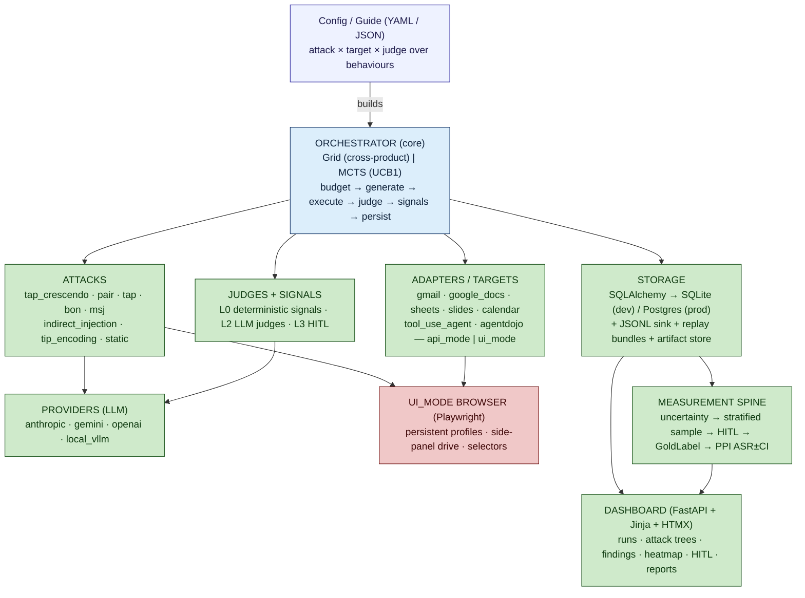

# Fission — High-Level Design (HLD)

> A single, self-contained design document for Fission: what it is, how it is structured,
> the major components and their contracts, the data that flows between them, the external
> interfaces, the deployment target, and the cross-cutting concerns (security, scale,
> observability) with the key design decisions and known risks.
>
> Scope: **high-level**. This is the architecture a reviewer reads to understand the whole
> system without opening the code. For where each thing lives, see
> [CODEBASE_MAP.md](CODEBASE_MAP.md); for the deep write-up and gap analysis, see
> [FISSION_ARCHITECTURE_AND_PRODUCTION.md](FISSION_ARCHITECTURE_AND_PRODUCTION.md); for the
> measurement design, see [FISSION_MEASUREMENT_SPINE.md](FISSION_MEASUREMENT_SPINE.md); for
> deployment, see [FISSION_DEPLOYMENT.md](FISSION_DEPLOYMENT.md).

---

## 1. Purpose and scope

**Fission is an adversarial-AI security testing harness for indirect prompt injection (IPI)
against Workspace-style AI assistants** (Gemini in Google Docs, Gmail, Sheets, Slides,
Calendar), plus tool-using agents. An operator describes a *behaviour* (the effect to
elicit), selects an *attack* (the strategy), points it at a *target* (the AI under test),
and *judges plus deterministic signals* decide whether the injection actually fired. Each
attempt is persisted as a *trace*; confirmed ones are promoted to *findings* with replayable
bundles, and results are rendered on a web dashboard.

**In scope for this design:**
- The run engine (orchestration, attacks, adapters, judges, providers, storage, dashboard).
- The reusable attack-recipe format (guides) and the seed corpus that feeds it.
- The measurement spine (calibrated attack-success rate with confidence intervals).
- The path from a local single-process tool to a deployed, continuous red-team service.

**Out of scope:** the specific adversarial payloads (sensitive, held in `attacks/payloads/`
and `seed_data/`), and the productionisation/compliance track, which is documented
separately under [production/](production/README.md).

---

## 2. Context — the system in its environment



**Actors and externals**
- **Operator** — runs assessments, reviews findings, labels the gold set.
- **Target under test** — Gemini surfaced inside Google Workspace, reached either through a
  live browser (ui_mode) or a model API (api_mode). This is what the assessment measures.
- **LLM providers** — the *attacker* model (crafts adversarial content) and the *judge*
  model (grades responses). Distinct role from the target.
- **Client / stakeholder** — receives the pilot deliverables (PDF/DOCX reports, replay
  bundles) exported from findings.

---

## 3. Architecture overview

Fission is a **pipeline of pluggable components behind a registry**. A run config names an
attack, a target, and a judge by string; the CLI resolves those names to classes and the
orchestrator drives the loop. Every component sits behind an abstract base class, so new
techniques, surfaces, and graders are added without touching the engine.



`UI_MODE` is drawn in red because live browser automation against the real Workspace UI is
the single biggest reliability and production risk (§9, §11).

**Layering, top to bottom**
1. **Interface** — CLI (`advtest`) and the FastAPI dashboard.
2. **Engine** — the orchestrator and the core data model.
3. **Pluggable components** — attacks, adapters/targets, judges/signals, providers.
4. **Persistence** — SQLAlchemy storage with parallel JSON and replay sinks.
5. **Measurement** — the spine that turns raw traces into a calibrated, defensible metric.

---

## 4. Component design

Each component is an abstract base with a small contract and a hand-maintained registry in
`advtest_ext/_cli_factories.py` mapping config strings to factory functions.

### 4.1 Orchestrator (`core/`)
Owns the run lifecycle. Two strategies share one base:
- **GridOrchestrator** — exhaustive attack × behaviour sweep, parallelised up to
  `max_concurrency` with an `asyncio.Semaphore`.
- **MctsOrchestrator** — UCB1 bandit over arms, early-exit on first success (guided search).

Responsibilities: budget tracking (`orch_budget.py`), trace persistence, an event bus, and
summary statistics (`orch_summary.py`). Verdicts are classified by score
(`≥0.5` success, `≥0.2` partial, else refused/error). The **layered oracle** rule lives
here: if a deterministic L0 signal fires, the verdict is upgraded to success even when the
LLM judge missed it.

### 4.2 Attacks (`attacks/`)
`AttackPlugin.generate()` is an async iterator that yields `AttackAttempt` objects.
`ComposedAttack` lets a payload generator compose with a delivery mechanism. Registered
techniques include `tap_crescendo` (the flagship — a TAP tree of Crescendo nodes with
multi-seed steering, seed chains, a confirm-judge hybrid, and cross-node history learning),
`pair`/`pair_indirect`, `tap`/`tap_indirect`, `bon`, `msj`, `pap`, `indirect_injection`
(a family of hiding techniques), `tip_encoding`, `static`, and `template`.

### 4.3 Adapters / targets (`adapters/`, `document/`)
Every target implements `DocumentTarget`: `setup` / `render_document` / `invoke` /
`teardown` / `reset` / `capabilities`. Each Workspace surface offers two modes:
- **api_mode** — exports document text and calls a model API. Deterministic, cheap, used in
  tests and calibration.
- **ui_mode** — drives a real Chromium browser via Playwright against the live Workspace UI:
  persistent signed-in profiles, human-like input, a selector registry, traffic
  interception, and streamed-response completion detection. This is the true engagement
  path and the fragile one.

Surfaces: `gmail`, `google_docs`, `sheets`, `slides`, `calendar`, plus `outlook` (a
cross-app bait sender) and agentic targets (`tool_use_agent`, `agentdojo`) for
unauthorized-action testing.

### 4.4 Judges and signals (`judges/`)
A layered oracle grades each response:
- **L0 — deterministic signals** (`signals/`): `token_appears`, `canary_appears`,
  `regex_match`, `http_response_shape`, `llm_judge_verdict`. Ground truth that can upgrade
  a verdict.
- **L2 — LLM judges**: `ipi_verdict` (injection-fired rubric), `decomposed_ipi`
  (attended / complied / harmful-effect axes), `retrieval_verdict`, `strong_reject`, plus
  model classifiers `harmbench`, `llama_guard`, `shield_gemma`. `ensemble.py` combines
  tiers and exposes disagreement.
- **L3 — human in the loop** (`hitl.py`): the review queue that feeds the gold set.

### 4.5 Providers (`providers/`)
`Provider.complete()` abstracts model backends with cost tracking: `anthropic` (plus a
cached variant), `gemini` (the usual target), `openai`, and `local_vllm` for free local
dev. Providers are configured by YAML profiles under `configs/`.

### 4.6 Guides (`guides/`)
A **guide** is human-authored JSON that compiles into a run — the reusable, replayable unit
of institutional attack knowledge. The `Guide` schema carries objective, target, success
criteria, `key_moves`, `setup_steps`, `carrier_payload`, a `mutation_surface` with typed
`mutation_operators`, `invariants`, and provenance. `to_tap_crescendo.py` compiles a guide
into an executable attack; `run.py` / `stage.py` / `mutation_runtime.py` execute and mutate
it. Guides are seeded from the normalised corpus in `seeds_corpus/`.

### 4.7 Storage (`storage/`)
SQLAlchemy ORM, SQLite by default and Postgres in production (same schema via
`create_all`). Three parallel sinks: the relational DB, a JSONL backup, and a replay-bundle
zip per finding. A pluggable artifact store writes to local disk or GCS.

### 4.8 Dashboard (`dashboard/`)
FastAPI + Jinja + HTMX (server-rendered, not a React SPA). Serves runs, Mermaid attack
trees with SVG caching, findings, a technique heatmap, the HITL review UI, the seed ledger,
calibration, and PDF/DOCX report export. App factory: `app.py:create_app`.

### 4.9 Measurement spine (`core/ppi.py`, `sampling.py`, `uncertainty.py`, `agreement.py`)
Turns raw traces into a **calibrated attack-success rate with a confidence interval**. The
oracle labels every trace cheaply; a stratified sampler (uniform slice plus
disagreement-weighted top-K) picks a subset for expert review; reviews become immutable
`GoldLabel` rows; prediction-powered inference (PPI) rectifies the oracle's full-run ASR by
the oracle-versus-expert disagreement on the uniform slice, yielding `ASR = x% ± y%` at 95%
confidence rather than an uncalibrated "the oracle said so."

---

## 5. Data model

Core tables in `storage/models.py`:

| Entity | Role |
|---|---|
| `Run` | One execution of a config: status, summary stats, timing. |
| `Trace` | One attempt (attack node): payload, response, verdict, score, `parent_id`/`depth` for the tree, `uncertainty`. |
| `JudgeScore` | A judge's score for a trace (score, flagged, reasoning, version). |
| `SignalRecord` | A deterministic L0 signal evaluation against a trace. |
| `Finding` | A promoted successful trace, with a replay bundle. |
| `HitlItem` | A queued trace awaiting human review (with `sample_reason`, `uncertainty`). |
| `GoldLabel` | An immutable expert label: frozen oracle prediction + expert verdict. Calibration ground truth and future training data. |
| `SeedRow` | A normalised corpus seed. |
| `RecipeRow` / `RecipeStepRow` | Multi-step recipe definitions. |
| `CalibrationExample` / `CalibrationResult` | External-dataset ingest and calibration output. |

The tree structure is hoisted onto `Trace` (`parent_id` + `depth`), so the dashboard renders
attack forests grouped by run phase directly from the DB.

---

## 6. Key runtime flows

### 6.1 One run, end to end
```
advtest run --config run.yaml
  → load_run_config() → RunConfig (single- or multi-phase)
  → _build_orchestrator(): resolve target / attacks / judge / signals from registries
  → orchestrator.run():
       target.setup(); create Run row (in_progress)
       for (attack, behaviour):                        [Grid: parallel to max_concurrency]
         async for attempt in attack.generate(behaviour, target, budget):
           reserve budget (short-circuit on BudgetExceeded)
           context = target.render_document(doc)
           response = target.invoke(context, prompt)    ← browser or API
           score = judge.score_response(...)
           verdict = classify(score)
           record Trace + evaluate/persist L0 signals
           if a signal fired and verdict ≠ success: upgrade to success   ← layered oracle
           maybe promote Finding (+ replay bundle)
       target.close(); finalise Run (completed) with SummaryStats
  → dashboard reads the DB → attack-tree forests + ASR ± CI
```

### 6.2 Measurement / gold-set loop
Completed run → oracle labels all traces → per-trace uncertainty → stratified sample
(uniform + disagreement) → HITL queue → ≤30s review card (with a blind-review fraction to
guard against anchoring) → immutable `GoldLabel` → PPI computes ASR ± CI → run-over-run
trend on the dashboard. The gold set both calibrates the current metric and accumulates the
training data for the downstream self-improvement flywheel.

---

## 7. External interfaces

**CLI (`advtest`, entry point in `pyproject.toml`)**
- `run` — execute a RunConfig YAML (`--config`, `--strategy grid|mcts`, model overrides).
- `ingest-seed`, `import-run`, `calibrate`, `rescore`, `run-recipe`.

**Dashboard HTTP API (FastAPI)** — server-rendered pages plus HTMX partials. Notable
routes: `/runs`, `/runs/{id}` (with `_hero`, `_heatmap`, `_tree`, `_timeline` partials and
`report.pdf` / `transcript-report.pdf`), `/findings`, `/hitl` and `/hitl/{id}/review`,
`/seeds`, `/playbooks`, `/calibration`, `/drift`, `/live-tests`. Health probes `/healthz`
and `/readyz` back the container orchestration.

**Configuration (environment)** — the `ADVTEST_*` variables, chiefly `ADVTEST_DB_URL`
(SQLite or Postgres), `ADVTEST_PROVIDER_CONFIG`, the Playwright profile/timeout/slow-mo
knobs, `ADVTEST_AUTH_MODE` and the Google credential settings, `ADVTEST_ARTIFACT_BACKEND` /
`ADVTEST_ARTIFACT_BUCKET` (local disk or GCS), and `ADVTEST_DASHBOARD_TOKEN` (bearer auth).

**External services** — the LLM provider APIs (Anthropic, Gemini, OpenAI) and the live
Google Workspace UI reached through signed-in browser profiles.

---

## 8. Deployment view

Today the system runs as a **single-process CLI plus the dashboard**; `docker-compose.yml`
brings up Postgres and the dashboard for a credential-free local demo. The Dockerfile builds
a slim app image (no browser); the browser-farm worker image extends it with Chromium.

The target topology is roughly five services (see [FISSION_DEPLOYMENT.md](FISSION_DEPLOYMENT.md)):
1. **Dashboard / API** — the existing FastAPI app, with auth added.
2. **Browser workers** — Playwright + Chromium, one browser per signed-in Google account.
3. **Scheduler / control plane** — net-new; allocates browser-session budget across
   regression-watch and frontier lanes and enqueues jobs on a cadence.
4. **Queue + broker** — Redis plus a job library, distributing jobs to workers.
5. **Managed state** — Postgres, object storage for artifacts, a secrets manager.

Staged rollout: make it deployable (Postgres, object storage, dashboard auth, secrets) →
queue plus a small worker fleet → the continuous scheduler → observability → governance
hardening. The **browser farm is roughly 80% of the effort**, and scaling it is gated on the
Google ask (test tenants, allowlisted accounts, ideally stable side-panel test hooks).

---

## 9. Cross-cutting concerns

**Security and data handling** — the dashboard holds findings and adversarial content;
production requires bearer auth (present as `ADVTEST_DASHBOARD_TOKEN`) plus real access
control. Secrets today live in env/YAML and must move to a manager with rotation. Replay
bundles capture raw request/response and need redaction and a retention/quarantine policy
before real customer data flows through. ui_mode plants real artifacts in real Drives and
inboxes, so teardown failure is a data-leakage risk.

**Reliability** — single-process asyncio with synchronous SQLite writes does not scale
horizontally; there are no retries/backoff/circuit-breakers yet, so transient target or
provider errors are terminal. Selectors drift whenever the Workspace UI changes and must be
re-validated before demos. These are the tracked P0/P1 gaps in
[FISSION_ARCHITECTURE_AND_PRODUCTION.md](FISSION_ARCHITECTURE_AND_PRODUCTION.md) §4.

**Cost and determinism** — judge LLM calls are the dominant cost (ensemble plus
confirm-judge can be 4+ calls per trace) and are largely unbudgeted; LLM judges are
non-deterministic, so replays may diverge. The measurement spine gates on agreement to keep
the headline metric honest.

**Observability** — `structlog` structured logging today; production adds log aggregation,
health metrics (sessions-per-finding, ASR trend, harness/account health), and alerting.

**Quality** — Ruff and mypy are configured in `pyproject.toml`; CI/CD workflows live in
`.github/workflows/` (`ci.yml`, `cd.yml`); ~85 test files run without GPU or live LLM by
default.

---

## 10. Key design decisions

| Decision | Rationale |
|---|---|
| **Registry-of-plugins over a monolith** | New attacks/targets/judges are added by implementing a base class and registering a factory string — the engine never changes. |
| **Layered oracle (L0 signals upgrade L2 verdicts)** | Deterministic ground truth (canaries, beacons) is trusted over a fallible LLM judge, cutting false negatives without hand-labelling every trace. |
| **PPI for the headline metric** | Gives a defensible ASR ± CI from a small expert sample plus the full-run oracle, instead of trusting the oracle outright. |
| **Server-rendered dashboard (FastAPI + Jinja + HTMX)** | Avoids an SPA build/runtime for an internal instrument-style tool; simpler to operate and extend. |
| **SQLAlchemy with SQLite→Postgres** | Same ORM and schema in dev and prod; the DB URL is the only switch, so deployment is plumbing, not a rewrite. |
| **api_mode + ui_mode per adapter** | Cheap, deterministic API path for tests/calibration; the live browser path for real engagements — same `DocumentTarget` contract. |
| **Guides as compilable JSON recipes** | Captures reusable, mutation-aware attack knowledge that compiles into runs and survives model changes. |

---

## 11. Known risks and open questions

- **Browser-farm tractability** is the top risk and is gated on the Google test-tenant ask;
  secure it in writing before scaling the fleet.
- **Selector fragility** — no automated drift detection yet; UI changes silently break runs.
- **No horizontal scale / no queue** in the current single-process engine.
- **Secrets, auth, and captured-data retention** are not production-grade.
- **Judge cost and non-determinism** are unbounded per trace and unbudgeted.

Each maps to a prioritised item in the architecture gap analysis and a staged deliverable in
the deployment plan.

---

## 12. Related documents

- [CODEBASE_MAP.md](CODEBASE_MAP.md) — where every subsystem lives in the tree.
- [FISSION_ARCHITECTURE_AND_PRODUCTION.md](FISSION_ARCHITECTURE_AND_PRODUCTION.md) — the
  full architecture, subsystem internals, and prioritised gap analysis.
- [FISSION_MEASUREMENT_SPINE.md](FISSION_MEASUREMENT_SPINE.md) — the ASR ± CI design.
- [FISSION_DEPLOYMENT.md](FISSION_DEPLOYMENT.md) — topology and the browser-farm effort.
- [FISSION_GUIDE_FORMAT.md](FISSION_GUIDE_FORMAT.md) — the guide schema.
- [FISSION_DIAGRAMS.md](FISSION_DIAGRAMS.md) — diagram sources.
