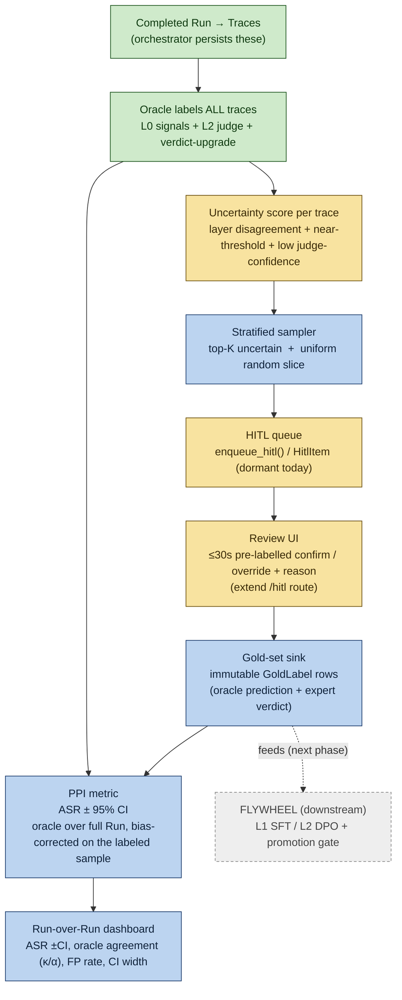

# Fission — Measurement Spine (detailed design)

> The **first thing to build** for (c). You cannot claim "self-improving" without a
> trustworthy, Run-over-Run improvement metric. The spine produces that metric AND
> grows the gold set that the flywheel later trains on. Most of it is **activate +
> extend** of plumbing that already exists (dormant HITL queue), not from-scratch.

## Legend

- 🟩 **EXISTS** — reuse as-is.
- 🟨 **ACTIVATE / EXTEND** — built but dormant, or needs a small extension.
- 🟦 **ADD** — new build.

---

## 1. The spine, end to end

---

## 2. Gold-set schema (the GoldLabel entity)

Each reviewed trace becomes ONE immutable labeled example. This is simultaneously the
**calibration ground truth** (for PPI) and the **training data** (for the flywheel).

| Field | Type | Why it's here |
|---|---|---|
| `id` | str | PK |
| `trace_id` | FK→Trace | which execution was labeled |
| `run_id` | FK→Run | which run it came from |
| `behavior_id` | str | for per-behavior calibration |
| `oracle_verdict` | enum | what L0–L2 said **at sample time** (frozen) |
| `oracle_score` | float | the judge score at sample time |
| `oracle_layers_fired` | json | which signals / judge fired (for L0↔expert audit) |
| `response_snapshot` | text | the scored text, frozen — label stays valid if the trace changes |
| `sample_reason` | enum | `disagreement` \| `uniform` (needed for unbiased PPI) |
| `expert_verdict` | enum | success / partial / refused — the ground truth |
| `expert_confidence` | int 1–5 | down-weights shaky labels |
| `reviewer_id` | str | inter-rater agreement, accountability |
| `review_seconds` | int | track the ≤30s budget |
| `reason` | text | why the expert overruled/confirmed (sharpens prompts later) |
| `reviewed_at` | datetime | versioning vs model/UI drift |
| `frozen` | bool | immutable once reviewed (audit integrity) |

---

## 3. Sampling design — why two slices

The oracle labels the **whole** run cheaply. Experts only label a **sample**. The sample
has two parts, and you need both:

- **Disagreement-weighted (top-K uncertain):** traces where layers disagree (L0 fired but
  the judge said no, or vice-versa), the judge score sits near the decision threshold, or
  judge confidence is low. This concentrates scarce expert time where the oracle is least
  sure — uncertainty sampling. *Reuses the `ensemble.py` disagreement logic that already exists.*
- **Uniform random slice:** a small unbiased sample across the whole run. **This is the
  load-bearing piece for PPI** — without it the gold set skews toward hard cases and the ASR
  estimate is biased. The uniform slice is what lets you make an *honest* population claim.

Sample size is set by your **label budget** (labels/week). That one number decides how big
each slice is and how many rounds until the L1 loop can plausibly close.

---

## 4. PPI metric — in plain English

You want the *true* attack-success rate but can only afford to expert-label a sample.

- Using only the small expert sample → unbiased but a **wide** CI (few labels).
- Using only the oracle over the full run → **tight** but **biased** (the oracle errs).
- **PPI (prediction-powered inference)** gives you the best of both: take the oracle's ASR
  over the *full* run, then **correct it** by the oracle-vs-expert disagreement measured on
  the labeled sample, and produce a CI that accounts for both the sample size and the
  oracle's reliability.

Output a reviewer can trust: **"ASR = 70% ± 3% at 95% CI"** — *not* "the oracle said 70%."
That single calibrated number is what makes every downstream improvement claim defensible.

---

## 5. Activate vs Add (the build list)

| Piece | Status | Work |
|---|---|---|
| Run → traces, oracle labels | 🟩 EXISTS | reuse |
| Uncertainty / disagreement scoring | 🟩 DONE | `core/uncertainty.py::score_uncertainty` (L0↔L2 conflict, uncorroborated success, near-threshold) wired into the orchestrator's default path → persisted on `Trace.uncertainty` (+reason). One-sided L0 handled (a non-fired signal is not refusal evidence). `tests/test_uncertainty.py`. |
| HITL queue (`HitlItem`, `enqueue_hitl`, `/hitl`) | 🟩 DONE | Activated in the default path: `Orchestrator._enqueue_review_sample` enqueues the stratified sample at run completion (opt-in via `review_sample_budget`, off by default). `HitlItem` gained `sample_reason` + `uncertainty` columns for GoldLabel/PPI provenance. |
| Review UI (≤30s pre-labelled confirm/override) | 🟩 DONE | `/hitl/{id}` review card (evidence + oracle call-out) + `POST /hitl/{id}/review` → writes a `GoldLabel`, resolves the queue item (confirmed=agree / rejected=overrule), auto-advances to the next pending. Keyboard-driven (S/P/R + 1-5). **Blind-review fraction** (`ADVTEST_HITL_BLIND_PCT`, default 20%, deterministic per item) hides the oracle verdict to guard anchoring. `tests/test_dashboard.py`. |
| Stratified sampler (uncertain + uniform) | 🟩 DONE | `core/sampling.py::stratified_sample` — uniform slice drawn first (unbiased), disagreement = top-K by uncertainty from the remainder, seeded/reproducible. `tests/test_sampling.py`. Config: `review_sample_budget` / `review_uniform_fraction` / `review_seed` (see `configs/run_with_review_sampling.yaml`). |
| Gold-set sink (`GoldLabel`) | 🟩 DONE | `storage/models.py::GoldLabel` + `insert/list/get/count_gold_labels` repository helpers + `tests/test_gold_set.py`. Immutable, frozen oracle prediction, `ON DELETE SET NULL` FKs + denormalised `behavior_id`/`response_snapshot` so labels outlive their run. |
| PPI metric (ASR ±CI) | 🟩 DONE | `core/ppi.py::ppi_asr` (rectify oracle ASR by oracle↔expert disagreement on the **uniform** slice; normal-approx CI; degrades to `oracle_only` with no labels) + `ppi_asr_for_run` glue. Surfaced on `/runs/{id}` hero as `ASR = x% ± y% (95% CI)` with a CI band. `tests/test_ppi.py`. |
| Run-over-Run trend dashboard | 🟨 PARTIAL | Run hero shows the calibrated headline; a dedicated run-over-run trend view (ASR ±CI across runs, NEW/REGRESSED/FIXED diff) is mocked in the redesign but not yet built as a live route. |

---

## 6. What this unblocks

1. **Labeling can start immediately** — the moment the gold-set schema + review UI exist,
   your experts label the §7 traces you already have. (Long pole; start in parallel.)
2. **The proof experiment becomes runnable** — once the gold set grows, stand up L1, SFT it,
   and show *L1 agreement-with-experts ↑ over K rounds with no L0 regression*. That single
   result validates the (c) thesis on the cheapest layer.
3. **Every later claim gets a CI** — "ASR dropped 8% ±3% after Gemini's update" instead of
   anecdote. This is the credibility moat for a Google/Anthropic audience.

The spine ends at **gold set + PPI metric + trend**. The flywheel (L1 SFT → L2 DPO →
promotion gate) is the next diagram, and it consumes the gold set this spine produces.

---

## 7. Pressure-test — open risks & the refinements they force

**Q: With only ONE judge (no L1, ensemble dormant), is "disagreement" a strong enough
uncertainty signal?** Short answer: yes to start, but it's weaker than a panel — and that
shapes the early design.

- **You still have three valid uncertainty axes without a second model:**
  (1) **L0↔L2 disagreement** — a deterministic signal fired but the judge said no (or vice
  versa). This is genuine *cross-method* disagreement (pattern-match vs LLM), and it's
  actually a strong signal. (2) **Near-threshold** judge score. (3) **Low judge
  self-confidence** (ipi_verdict already emits confidence 1–5). So uncertainty sampling works
  on day one — it just leans on L0↔L2 + confidence rather than judge-vs-judge spread.

- **Refinement 1 — weight the uniform slice HEAVILY at first, shift to disagreement as L1
  comes online.** Early on the only "second opinion" is L0; once L1 exists you get a true
  second decision method to disagree against, which sharpens uncertainty sampling. So the
  spine **bootstraps L1, and L1 sharpens the spine** — a virtuous loop. Make the
  uniform:disagreement ratio a tunable that starts high (exploration) and decays.

- **Refinement 2 — cold-start phase.** Before any gold set exists you can't trust *any*
  uncertainty signal. The first 1–2 runs: label a larger **uniform** sample to establish
  baseline oracle accuracy, *then* turn on uncertainty-weighting.
  - **Calibration set (implemented).** To measure the oracle *before* any in-house label
    exists, ingest PUBLIC labelled benchmarks (several from the curated catalogue carry
    ground-truth success labels) as a cold-start validation set: `advtest_ext.calibration`
    + `configs/calibration_datasets.yaml` + `storage.CalibrationExample`. Run the oracle
    over these and report F1/ECE from day one. Distinct from the gold set: an external input
    with a known verdict but no *frozen oracle prediction* — you generate the prediction by
    running your oracle, which is exactly the judge-calibration measurement. Ingest with
    `scripts/ingest_calibration.py --dataset <slug> --path <dump.jsonl>`.
  - **Calibration report (implemented).** The scoring half of the loop:
    `scripts/run_calibration.py` runs the LLM judge over the ingested examples (those that
    ship a response) → `storage.CalibrationResult` rows; `core/calibration_report.py` computes
    **precision / recall / F1** (agreement) and **ECE** (are the confidence scores honest?),
    overall and per dataset / attack-type. Surfaced on the dashboard's **Calibration** tab
    (confusion matrix + reliability curve + per-stratum F1). Metrics are pure/unit-tested;
    the LLM runner is operational. This gives a reviewer the pair they want: a calibrated ASR
    *and* a validated instrument ("F1 0.9 / ECE 0.04 vs 12 public benchmarks").

- **Refinement 3 — blind-spot guard (already partly designed).** Uncertainty sampling never
  surfaces the oracle's *unknown unknowns* (cases it's confidently wrong about). The uniform
  slice is the only thing that catches those — so it must stay non-trivial, permanently, not
  just at cold-start. This is *why* §3 insists on two slices.

- **Refinement 4 — anchoring risk in the ≤30s pre-labelled review.** Showing the expert "the
  oracle says SUCCESS — confirm?" invites rubber-stamping (confirmation bias), which would
  silently inflate measured oracle accuracy. **Mitigation:** blind a random fraction of
  reviews (hide the oracle verdict, show only evidence); compare blind-vs-prelabelled
  override rates to detect/quantify anchoring.

- **Refinement 5 — inter-rater reliability, not just oracle-vs-expert.** PPI assumes the
  expert label *is* ground truth. If your experts disagree with *each other*, that premise is
  shaky. **Mitigation:** double-label a small fraction (`reviewer_id` is already in the
  schema) and track expert↔expert κ; if it's low, the behavior's success criteria need
  tightening before its numbers are trustworthy.

- **PPI validity under a moving oracle:** the flywheel changes the oracle between runs. Safe
  because `oracle_verdict`/`oracle_score` are **frozen at sample time** in the gold label, so
  each run's PPI uses the predictor that actually labeled it. (Schema already handles this.)

**Net:** the spine is sound on a single judge, *provided* the uniform slice carries more
weight early, cold-start uses uniform-only, a fraction of reviews are blind, and you track
inter-rater κ. None of these are new components — they're parameters and a small blind-review
toggle on the review UI.
