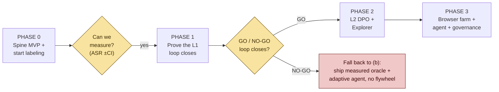

# Fission — Phased Roadmap to (c)

> A **de-risking plan**, not a feature list. The whole (c) thesis ("self-improving") rests on
> one unproven empirical question — *does the flywheel close?* — so **Phase 1 is a GO/NO-GO
> gate** that answers it cheaply, *before* the expensive build (browser farm, agent, Explorer).
>
> Reads against [Build Map](FISSION_BUILD_MAP.md) · [Spine](FISSION_MEASUREMENT_SPINE.md) · [Flywheel](FISSION_FLYWHEEL.md).

---

## Phase 0 — Spine MVP + start labeling  *(the prerequisite)*
- **Objective:** be able to *measure* — produce a calibrated ASR ±CI for one Run, and start a gold set.
- **Build:** `GoldLabel` table; activate the dormant HITL enqueue; stratified sampler (uniform-heavy at first); ≤30s review UI (extend `/hitl`, with a blind-review fraction); PPI metric on one Run.
- **Exit gate (G0):** one Run reports `ASR = x% ± y% (95% CI)` and the gold set is growing.
- **Dependency / what you learn here:** your real **labels/week** rate — which sizes everything after. (You learn it by doing, not by estimating.)

## Phase 1 — Prove the L1 loop closes  *(the decisive GO/NO-GO)*
- **Objective:** answer the one question (c) stands on — *does self-improvement work at all?*
- **Build:** L1 as a real classifier tier (start from a pretrained attack-success classifier); SFT on the gold set; the promotion gate's K1 (gold-set F1) + K2 (L0-regression audit).
- **Exit gate (G1) — the pivotal decision:**
  - **GO** if, over K rounds: L1 macro-F1 vs experts **↑**, L1↔L0 agreement **flat** (no reward-hacking), and L1 **beats the frozen baseline** (ablation). → fund and build the rest of (c).
  - **NO-GO** if it doesn't move within a realistic label budget → **fall back to (b)**: ship the measured oracle + adaptive agent *without* the self-improving claim. Still a strong, defensible product — you just learned it cheaply instead of after a 6-month build.

## Phase 2 — Expand the oracle + Explorer  *(only after GO)*
- **Objective:** widen self-improvement and automate variant generation.
- **Build:** L2 DPO (judge) on expert overrides; Explorer (quality-diversity variants) behind G1/G2/G3 gates; coverage reporting.
- **Exit:** L2 improves under the full promotion gate; Explorer variants pass gates and grow MAP-Elites coverage without flooding noise.

## Phase 3 — Scale + autonomy + governance  *(productionize)*
- **Objective:** run continuously, unattended, in-scope.
- **Build:** headless **browser farm** (containerized, per-session isolation, drift detection); **action-level Replayer agent** (observe–decide–act–verify); **scope/consent enforcement** + provenance + rollback + kill-switch.
- **Exit:** continuous, autonomous Runs that stay within engagement scope and keep pace with Gemini drift.

---

## Cross-cutting (not a phase — threads through all)
- **Governance scope-gate** comes forward to whenever you first touch a *client's* systems (vs your own test targets).
- **Inter-rater κ** + blind-review anchoring checks run continuously from Phase 0 (they protect the gold set's integrity).

## The one thing to internalize
**Phase 1 is a cheap experiment that decides whether (c) is real.** Everything visually
"impressive" (the agent, the farm, the Explorer) is Phase 2–3 and should not be built until
Phase 1 says GO. Front-loading the GO/NO-GO is the difference between a fundable plan and a
6-month bet on an unproven loop.

## Start-here (this/next week)
1. Define `GoldLabel` + the review UI (Phase 0 build is small — mostly activating existing plumbing).
2. Point your experts at the §7 Runs you already have → start the gold set today.
3. The moment ~a few hundred labels exist, run the Phase-1 spike on L1.
