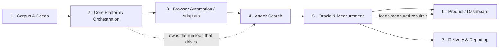

# The Team — Fission as owned components

> This doc describes Fission **as if a 7-person engineering team built it**: each role's
> mission, the code they own, what they're responsible for, who they hand off to, and what
> to read first. It's a companion to the [architecture stage docs](architecture/README.md) —
> every stage there maps to a role here.
>
> Reality note: today the codebase was largely built in one long effort, so these roles are a
> *lens for understanding and dividing the work*, not a current org chart. Ownership is by
> **concern**, which mostly — but not perfectly — follows directory boundaries (the biggest
> exception is called out under "Seams").

## Team at a glance

| # | Role | One-line mission | Primary code | Stage docs |
|---|------|------------------|--------------|-----------|
| 1 | **Corpus & Seeds Engineer** | Curate the attacks we test and keep the seed corpus healthy. | `guides/` (model + generators), `guides/*.yaml`, `seeds_corpus/`, `seed_data/` | [1](architecture/01-corpus-and-seeds.md) |
| 2 | **Core Platform / Orchestration Engineer** | The engine: turn a config into a run, stage scenarios, persist everything. | `core/`, `guides/stage.py`, `storage/`, `providers/`, `cli.py` | [2](architecture/02-staging-and-recipes.md), [6](architecture/06-orchestration-and-core.md) |
| 3 | **Browser-Automation / Adapters Engineer** | Drive real Gemini in a browser, reliably, past selector drift and logins. | `adapters/`, `adapters/_ui_mode_common/`, `document/`, `scripts/heal_selectors.py`, `scripts/login_profile.py` | [3](architecture/03-target-adapters.md) |
| 4 | **Attack-Search Engineer** | Find attacks that work: the TAP-crescendo tree, mutation, pruning. | `attacks/`, `guides/to_tap_crescendo.py` | [4](architecture/04-attack-search.md) |
| 5 | **Oracle & Measurement Scientist** | Decide what counts as success, and report it with confidence. | `judges/`, `calibration/`, `core/ppi.py`+`sampling.py`+`uncertainty.py`+`agreement.py`, `advtest_ext/archive/` | [5](architecture/05-oracle-and-scoring.md), [7](architecture/07-measurement-spine.md) |
| 6 | **Product Engineer (Dashboard)** | The web app people use to launch runs and read results. | `dashboard/` | [8](architecture/08-dashboard.md) |
| 7 | **Delivery & Reporting Engineer** | Turn results into a client-ready deliverable. | `delivery/` | [9](architecture/09-delivery.md) |

---

## 1. Corpus & Seeds Engineer

- **Mission:** Own *what we test*. Every attack starts as a **guide**; this role keeps the
  guide model coherent, curates the seed corpus, and turns real engagement findings and
  external research into new, runnable seeds.
- **Owns:** `advtest_ext/guides/models.py` (the `Guide` type), `guides/cell_generator.py` &
  `guides/seed_generator.py` (LLM-assisted authoring), the `guides/*.yaml` corpus,
  `seeds_corpus/` (normalized corpus) and `seed_data/` (raw, sensitive material),
  `scripts/generate_seeds.py`, `scripts/ingest_seeds.py`.
- **Responsibilities:** guide schema and validation; corpus quality and lifecycle
  (discovery → gold); cover/payload split and mutation-operator authoring; ingesting external
  techniques (e.g. channel exports) into seeds.
- **Interfaces with:** **Attack-Search** (guides must map cleanly via `map_guide`) and
  **Oracle** (a guide's `success.signals`/`rubric` are the oracle's contract).
- **Skills:** threat modelling, prompt-injection technique knowledge, data hygiene.
- **Read first:** [Stage 1](architecture/01-corpus-and-seeds.md), `docs/SEED_AUTHORING_GUIDE.md`,
  `docs/FISSION_GUIDE_FORMAT.md`.

## 2. Core Platform / Orchestration Engineer

- **Mission:** Own *how a run runs*. Configs in → executed cells → traces + findings out.
  Also owns **staging**: turning a guide into a live, planted scenario.
- **Owns:** `core/orchestrator.py` (`GridOrchestrator`, `MctsOrchestrator`), `core/models.py`
  (`RunConfig`, `RunResult`, `Budget`), the recipe engine (`core/recipe.py`,
  `recipe_runner.py`, `recipe_operations.py`), `guides/stage.py` (`build_setup_recipe`),
  `core/account_pool.py`, `core/surface.py`, `storage/`, `providers/`, `cli.py`.
- **Responsibilities:** the run loop and budgets; recipe staging + carrier planting; the
  multi-account model (attacker/recipient/bystander → creds + browser profiles);
  persistence; provider/model wiring; the CLI.
- **Interfaces with:** **everyone** — it's the spine. Hands scenarios to **Adapters**, drives
  **Attack Search**, persists for **Oracle/Dashboard/Delivery**.
- **Skills:** systems/pipeline design, async Python, data modelling, auth plumbing.
- **Read first:** [Stage 2](architecture/02-staging-and-recipes.md),
  [Stage 6](architecture/06-orchestration-and-core.md), `docs/ACCOUNTS_AND_AUTH.md`.

## 3. Browser-Automation / Adapters Engineer

- **Mission:** Own *how we reach the target*. Drive the real Gemini side panel in Gmail /
  Docs / Sheets / etc. through a logged-in browser, and keep it working as Google's UI shifts.
- **Owns:** `adapters/<app>/ui_mode/` (invokers, selectors, multi-turn targets) for gmail,
  google_docs, sheets, calendar, slides, outlook; `adapters/_ui_mode_common/` (session,
  selector overlay, `response_assembly`, playwright helpers); `document/` (format-independent
  doc model); `scripts/heal_selectors.py`; `scripts/login_profile.py`.
- **Responsibilities:** Playwright automation and stealth; selector healing/overlays;
  side-panel response + `model_thoughts` capture; carrier planting via UI; profile/login
  management. Owns the `SidePanelUnavailable` failure surface.
- **Interfaces with:** **Attack Search** (implements `target.invoke()`/`reset()`),
  **Core Platform** (session pooling, account profiles).
- **Skills:** Playwright/browser automation, DOM/selector resilience, dealing with anti-bot
  and UI churn.
- **Read first:** [Stage 3](architecture/03-target-adapters.md), `docs/SHEETS_UI_MODE_RUNBOOK.md`,
  `docs/WS3_LIVE_VALIDATION_RUNBOOK.md`.

## 4. Attack-Search Engineer

- **Mission:** Own *finding attacks that work*. The TAP-crescendo tree: propose strategies,
  write turns, branch, score, prune, adapt.
- **Owns:** `attacks/tap_crescendo.py` (flagship), `attacks/tap_search.py` (search primitives
  + in-run MAP-Elites), `attacks/tap_chain.py`, `guides/to_tap_crescendo.py` (the guide→attack
  bridge).
- **Responsibilities:** the tree search and Crescendo turn loop; mutation taxonomy; the
  planner/executor/verifier split and diagnose→adapt; `benign_user_turns` correctness;
  in-run diversity/coverage.
- **Interfaces with:** **Corpus** (consumes guides), **Adapters** (calls the target),
  **Oracle** (delegates scoring/verdicts).
- **Skills:** LLM red-teaming, search algorithms (tree search, MAP-Elites), prompt
  engineering, careful evaluation design.
- **Read first:** [Stage 4](architecture/04-attack-search.md) (the exemplar),
  `docs/SEARCH_TREE_DESIGN.md`, `docs/MUTATION_AXES_TAXONOMY.md`.

## 5. Oracle & Measurement Scientist

- **Mission:** Own *the truth*. Decide whether an attempt actually succeeded (not just "no
  refusal"), and report attack-success rates honestly with uncertainty and drift.
- **Owns:** `judges/` (`ipi_verdict.py`, `retrieval_verdict*.py`, `signals/`), `calibration/`,
  the measurement spine in `core/` (`ppi.py`, `sampling.py`, `uncertainty.py`, `agreement.py`),
  and the offline `advtest_ext/archive/` fingerprint (`signature.py`, `posterior.py`,
  `fingerprint.py`, `backfill.py`), plus `core/rescore.py`.
- **Responsibilities:** the deterministic signal oracle + LLM judges; the decomposed oracle
  (attended / complied / harmful-effect); judge calibration (never on the oracle's own
  verdict); ASR ± confidence intervals; cross-run vulnerability fingerprint + target drift.
- **Interfaces with:** **Attack Search** (provides judge + confirm judge + signals),
  **Corpus** (signals are authored per guide), **Dashboard/Delivery** (measured results).
- **Skills:** statistics/measurement, LLM-as-judge design, calibration, healthy scepticism
  about false positives/negatives.
- **Read first:** [Stage 5](architecture/05-oracle-and-scoring.md),
  [Stage 7](architecture/07-measurement-spine.md), `docs/FISSION_MEASUREMENT_SPINE.md`.

## 6. Product Engineer (Dashboard)

- **Mission:** Own *the surface people use*. Launch runs, watch them live, read transcripts
  and findings.
- **Owns:** `dashboard/` — FastAPI + Jinja + HTMX app, `live_tests.py`, `report.py`,
  `services.py`, `transcript.py`, and `templates/`.
- **Responsibilities:** run launcher + queue; live-progress views (staging plan, crescendo
  turns, SIGNAL-VERIFIED vs JUDGE-ONLY badges); trace/transcript rendering; seeds/playbooks
  views; the instrument-panel visual design.
- **Interfaces with:** **Core Platform** (launches runs, reads storage), **Oracle** (renders
  verdicts/scores), **Delivery** (shares the report layout).
- **Skills:** full-stack web (FastAPI/Jinja/HTMX), UX, careful rendering of noisy data.
- **Read first:** [Stage 8](architecture/08-dashboard.md), `docs/GETTING_STARTED.md`.

## 7. Delivery & Reporting Engineer

- **Mission:** Own *the client deliverable*. Turn stored results into the accurate, structured
  artifacts a customer can act on.
- **Owns:** `delivery/` — the per-attack **JSON** dataset (`export.py`, `schema.py`),
  harm taxonomy, journeys, and the validation recorder. Also owns the *content and correctness*
  of the client PDF reports, which are **rendered in `dashboard/report.py` + `disclosure_pdf`**
  (a seam shared with the Product Engineer — see below).
- **Responsibilities:** the pilot delivery JSON schema; the validation gate (only
  effect-verified episodes ship as successes); harm/journey/standards tagging; ensuring what
  ships matches what the oracle actually verified.
- **Interfaces with:** **Oracle** (source of truth for findings), **Dashboard** (shared
  report layout), **Core Platform** (reads storage).
- **Skills:** document generation, information design, precision/faithfulness.
- **Read first:** [Stage 9](architecture/09-delivery.md), `docs/PILOT_DELIVERY_FORMAT.md`.

---

## Seams — where ownership crosses directory lines

Real systems don't split cleanly by folder. The ones to know:

- **The measurement spine lives in `core/` but is owned by the Oracle Scientist (role 5),
  not the Platform Engineer (role 2).** `core/ppi.py`, `sampling.py`, `uncertainty.py`,
  `agreement.py` are statistics, not orchestration.
- **`guides/` is split.** The `Guide` model + generators are Corpus (role 1);
  `guides/stage.py` (staging) is Platform (role 2); `guides/to_tap_crescendo.py` (the
  attack bridge) is Attack Search (role 4).
- **Two "archives".** The in-run `DiversityArchive` (`attacks/tap_search.py`) is Attack
  Search (role 4); the offline `advtest_ext/archive/` fingerprint is Oracle/Measurement
  (role 5). Same vocabulary, different owners.
- **`scripts/` is shared.** Each script belongs to whichever role owns its subsystem
  (`run_guide.py` → Attack Search; `heal_selectors.py`/`login_profile.py` → Adapters;
  `generate_seeds.py` → Corpus).
- **The client deliverable is split across two roles.** Delivery (role 7) owns the **JSON**
  dataset (`delivery/`); the client **PDF** reports are rendered in the Dashboard
  (`dashboard/report.py`, `disclosure_pdf`) but their content/correctness is Delivery's
  concern. Product (role 6) owns the rendering; Delivery owns what's in it.

## Quick "who owns X?"

| I need to change… | Role | Start file |
|---|---|---|
| a new attack idea / seed | 1 · Corpus | `guides/models.py`, a new `guides/*.yaml` |
| the guide schema | 1 · Corpus | `guides/models.py` |
| how a run is staged / planted | 2 · Platform | `guides/stage.py` |
| the run loop / budgets | 2 · Platform | `core/orchestrator.py` |
| how we drive Gemini in a browser | 3 · Adapters | `adapters/<app>/ui_mode/invoker.py` |
| a drifted selector | 3 · Adapters | `scripts/heal_selectors.py` |
| the search / mutation / pruning | 4 · Attack Search | `attacks/tap_crescendo.py` |
| what counts as success | 5 · Oracle | `judges/ipi_verdict.py`, `judges/signals/` |
| ASR / confidence / drift | 5 · Oracle | `core/ppi.py`, `advtest_ext/archive/` |
| the web UI | 6 · Dashboard | `dashboard/app.py`, `dashboard/templates/` |
| the client JSON dataset | 7 · Delivery | `delivery/export.py` |
| the client PDF report | 6 renders / 7 owns content | `dashboard/report.py`, `disclosure_pdf` |
