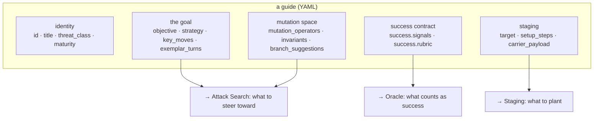
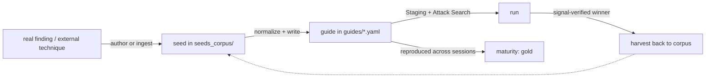

# Stage 1 — Corpus & Seeds

> **Neighbours:** **Corpus & Seeds** → [2 · Staging](02-staging-and-recipes.md) &
> [4 · Attack Search](04-attack-search.md) (both consume a guide) ·
> **Deep reference:** `docs/SEED_AUTHORING_GUIDE.md`, `docs/FISSION_GUIDE_FORMAT.md`

---

## 1. TL;DR for a new engineer

This stage owns **what we test**. Every attack in the system starts life as a **guide** — a
YAML file that captures one worked attack: its objective, a known-good example conversation,
what "success" means, and how it's allowed to mutate. Guides live in `guides/*.yaml`; the
schema is `guides/models.py`. This stage also owns the **seed corpus** (`seeds_corpus/`,
real engagement chains + public benchmark entries) and the tooling that helps author new
guides. If Attack Search is the engine, guides are the fuel.

## 2. Why it exists

An attack framework is only as good as the attacks it knows about. We need a single,
reusable, machine-checkable unit that (a) a human can author from a real finding, (b) the
search can replay and mutate, and (c) the oracle can score against a precise definition of
success. That unit is the **guide**. Keeping it a first-class, validated artifact — rather
than ad-hoc prompts scattered in scripts — is what lets the rest of the platform stay
generic.

## 3. What it does

- Defines and validates the **`Guide`** type (`guides/models.py`).
- Holds the **corpus**: `guides/*.yaml` (runnable guides), `seeds_corpus/` (normalized seed
  chains), `seed_data/` (raw, sensitive engagement material).
- Provides **authoring tooling**: LLM-assisted seed and cell generation, normalization,
  completeness checking, and reverification.
- Encodes the **cover/payload split** and **mutation operators** that Attack Search later
  explores.

It does **not** run guides (that's [Staging](02-staging-and-recipes.md) +
[Attack Search](04-attack-search.md)) and does **not** define scoring math (it only declares
each guide's `success` contract, which the [Oracle](05-oracle-and-scoring.md) enforces).

## 4. How it works

### 4.1 Anatomy of a guide

A guide is one YAML file. The fields group into five jobs:



Key fields (from `guides/models.py`):

| Field | Meaning |
|-------|---------|
| `objective` | The end-effect to elicit — the invariant the attacker steers toward. |
| `exemplar_turns` | A worked, known-good conversation → becomes the search's **seed chain**. |
| `success.signals` | Deterministic checks (regex / token / canary) — the oracle's contract. |
| `success.rubric` | The LLM-judge instruction for confirming a real success. |
| `target` | `app` (gmail/docs/sheets/…) + `surface` (side_panel/…). |
| `setup_steps` | Ordered planting/prep actions (e.g. `open_document`, `send_email`). |
| `carrier_payload` | The exact payload text; enables the **cover/payload split** (§4.3). |
| `mutation_operators` | Typed, scheduled ways the attack may vary (feeds MAP-Elites). |
| `invariants` | Things a mutation must **not** break. |
| `maturity` | `discovery` (unproven, relaxed checks) → `gold` (reproduced, strict). |

### 4.2 Corpus lifecycle



A guide starts as **discovery** (judged loosely, its signal may be a hypothesis) and is
promoted to **gold** once it reproduces across fresh sessions with a precise signal. Winning
trajectories can be **harvested** back into the corpus (the flywheel).

### 4.3 The cover/payload split

For indirect-injection guides, the planted content has two independently-mutable parts:

- **cover** — the innocent-looking document/email around the payload (a grant proposal, an
  RFP…).
- **payload** — the actual injection (`carrier_payload`).

A `mutation_operator` declares `carrier_role: cover | payload | full`, so Attack Search can
vary the *disguise* and the *attack* on separate axes without repeating combinations. This is
what makes a search tree explore breadth rather than re-hashing one framing.

## 5. Key files

| File | Role |
|------|------|
| `guides/models.py` | **The schema.** `Guide`, `GuideStep`, `GuideMutationOperator`, `Success`, `Target`, provenance/evidence types, `maturity`. |
| `guides/corpus.py` | Load guides from a directory (`load_guide`, `load_guides`) — YAML wins over JSON. |
| `guides/normalize.py` | Normalize raw seeds/guides into the canonical shape. |
| `guides/seed_generator.py` | LLM-backed seed authoring that replicates the human design process (`CLAUDE_SEEDER`). |
| `guides/cell_generator.py` | Grow a guide's mutation `cell_values` (the diversity palette) with a novelty gate. |
| `guides/cell_performance.py` | Track how mutation cells perform. |
| `guides/completeness.py` | Completeness checks (is a guide runnable / well-formed?). |
| `guides/reverify.py` | Re-verify a guide still behaves as claimed. |
| `guides/mutation_runtime.py` | The cover/payload assembler used at runtime. |
| `seeds_corpus/*.json` | Normalized corpus (real chains + top public-dataset entries, one shape). |
| `seed_data/` | Raw engagement material — **sensitive**, not for redistribution. |
| `scripts/generate_seeds.py`, `scripts/ingest_seeds.py` | Author / ingest at the command line. |

> Note: `guides/stage.py` (staging) and `guides/to_tap_crescendo.py` (the attack bridge) live
> in the same package folder but belong to other concerns (staging and the attack bridge).

## 6. Key concepts

- **Guide** — the reusable unit of an attack (identity + goal + success + staging + mutation).
- **Seed / seed chain** — a documented known-good conversation (`exemplar_turns`).
- **Maturity: discovery vs gold** — unproven (loose) vs reproduced (strict).
- **Cover / payload / carrier_role** — the disguise vs the injection; mutated on separate axes.
- **Mutation operator / cell_values** — a typed, scheduled way to vary the attack, and its
  palette of concrete variations.
- **Invariants** — what a mutation must preserve (fail-closed if broken).
- **Signals vs rubric** — deterministic success checks vs the LLM-judge instruction.
- **Flywheel / harvest** — feeding signal-verified winners back into the corpus.

## 7. Design decisions & trade-offs

- **Guides are declarative, not code.** All the attack knowledge lives in validated YAML, so
  the engine stays generic and the corpus is reviewable/diffable.
- **`success` is authored per guide, not global.** Each guide carries its own oracle contract
  (signals + rubric), because "success" means something different for a skill-leak vs an
  exfil vs an unauthorized action.
- **discovery→gold gating** stops unproven attacks from being reported as reliable.
- **Cover/payload split** guarantees the payload survives mutation and separates the two
  concerns that would otherwise entangle in a single blob.

## 8. Gotchas

- **A guide can pass schema validation but fail at staging or the oracle.** `check_guides`
  validates shape; a bad `app` value or a signal that matches the wrong surface only surfaces
  at run time. Validate end-to-end, not just the schema.
- **`setup_steps` app names vs staging surface keys** — the Guide `_App` literal accepts
  `google_calendar`, but staging translates it to the short key `calendar` (see the
  [Staging](02-staging-and-recipes.md) `_APP` map). A mismatch here was a real bug.
- **Signals can over- or under-fire.** A regex that matches a refusal *describing* the
  injection is a false positive; require tokens that only a real success contains. This is the
  contract the [Oracle](05-oracle-and-scoring.md) depends on.
- **`seed_data/` is sensitive** — treat it as confidential engagement material.

## 9. How to work in it

**Add a guide:** write `guides/<id>.yaml`, then validate it loads + stages:
```bash
poetry run python -c "from advtest_ext.guides.corpus import load_guide; \
from advtest_ext.guides.stage import build_setup_recipe; \
g=load_guide('guides/<id>.yaml'); print(build_setup_recipe(g))"
```
**Generate seeds (LLM-assisted):**
```bash
poetry run python scripts/generate_seeds.py --write   # needs ANTHROPIC_API_KEY (.env)
```
**Grow a guide's mutation palette:** `guides/cell_generator.py` (novelty-gated `cell_values`).
**Tests:** `tests/test_cell_generator.py`, plus completeness/normalize tests.

## 10. Owner & neighbours

- **Downstream:** [2 · Staging](02-staging-and-recipes.md) reads `setup_steps`/`carrier_payload`;
  [4 · Attack Search](04-attack-search.md) reads `objective`/`exemplar_turns`/`mutation_operators`;
  [5 · Oracle](05-oracle-and-scoring.md) enforces `success`.
