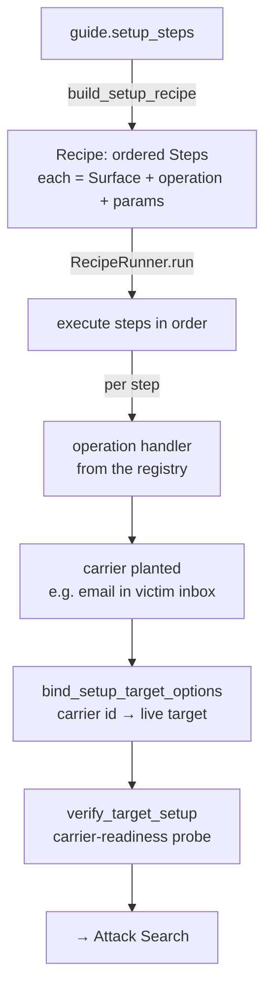

# Stage 2 — Staging & Recipes

> **Owner role:** [Core Platform / Orchestration Engineer](../TEAM.md#2-core-platform--orchestration-engineer) ·
> **Neighbours:** [1 · Corpus](01-corpus-and-seeds.md) (authors `setup_steps`) → **Staging** →
> [3 · Adapters](03-target-adapters.md) (plants via UI) → [4 · Attack Search](04-attack-search.md) ·
> **Deep reference:** `docs/ACCOUNTS_AND_AUTH.md`, `docs/INTEGRATION_CONTRACT.md`

---

## 1. TL;DR for a new engineer

Before an attack can run, someone has to **set the scene**: plant the poisoned email in the
victim's inbox, create the shared doc, make the calendar event — *from the right account*. That
"set the scene" layer is staging. It turns a guide's `setup_steps` into a **Recipe** (an
ordered list of concrete steps), runs it against the correct account, then **verifies** the
planted content is actually visible to Gemini before turn 1. The Recipe engine (`core/recipe*`)
is also a general-purpose way to script multi-account, multi-app chains.

## 2. Why it exists

An indirect-injection test is only valid if the payload arrives the way a real attacker would
deliver it — an *external* sender emailing the victim, not the victim planting it themselves.
That means staging must (a) act as the *attacker* account, (b) plant real content in the
victim's Workspace, and (c) confirm Gemini can actually see it. If any of that silently falls
back to the wrong identity, "the run passes while testing nothing" — so staging is built to
fail *loudly* and verify *before* the attack starts.

## 3. What it does

- Projects a guide's `setup_steps` into a runnable **Recipe** (`build_setup_recipe`).
- Executes the Recipe with the **RecipeRunner**, resolving each step to an operation handler and
  the right account session.
- Plants carriers through the **UI-mode `recipe_ops`** (send email, create doc/event) — see
  [Adapters](03-target-adapters.md).
- **Verifies** the plant: checks step outputs, binds the planted carrier id into the live
  target, and runs a **carrier-readiness probe** so the attack doesn't start against content
  Gemini can't yet see.

## 4. How it works

### 4.1 From guide to planted scenario



- **`build_setup_recipe(guide)`** maps each `setup_step` through `_APP` (guide app →
  short Surface app) and `_ROLE` (account role), derives the `region` from the operation
  (`send_email→compose`, `type_prompt→sidebar`, else `main`), renders `{{var}}` setup
  variables, and emits a `Step` with `on_fail="abort"`.
- **`RecipeRunner.run()`** iterates steps in order, accumulating each step's outputs so later
  steps can reference them with `{{step.<id>.<field>}}` (e.g. a `reply` step uses the plant
  step's `thread_id`).
- **`verify_target_setup`** opens the carrier and loops the guide's readiness probe
  (`probe_prompt` + `expected_pattern`) with exponential backoff — raising *"carrier readiness
  probe did not confirm indexed/visible content"* if Gemini never sees it.

### 4.2 The address model — `Surface`

Every step happens at a **`Surface`** = `(app, region, account_role, document_id?)`. These are
discriminated `Literal` types, so a typo in a config fails at load, not at run:

| Part | Values |
|------|--------|
| `app` | docs · gmail · sheets · calendar · drive · slides · gemini_app · outlook |
| `region` | sidebar (the Gemini panel) · main · compose · thread_list · chat |
| `account_role` | recipient · attacker_sender · outlook_sender · bystander |

### 4.3 Accounts — the right identity per step

Account roles map to **profiles and/or tokens**:

- `recipient` → the victim's logged-in Chrome profile (and, for API plants, an OAuth token).
- `attacker_sender` / `outlook_sender` → the *attacker's* identity (a separate profile;
  `outlook_sender` is **UI-only** — the signed-in Chrome profile *is* the credential, no OAuth).
- `bystander` → a third party.

`preflight_setup_accounts` verifies these **before** the run: an API-plant role needs its OAuth
token, a UI-only role needs its profile dir. Missing → fail loudly (never silent fallback).

## 5. Key files

| File | Role |
|------|------|
| `core/surface.py` | The `Surface` address type (`App`/`Region`/`AccountRole` literals). |
| `core/recipe.py` | `Recipe` / `Step` / `MutationSurface` data model + `content_hash`. |
| `core/recipe_operations.py` | `OperationRegistry` (`(app,operation)→handler`), `OperationContext`/`OperationResult`, `require_str_param`. |
| `core/recipe_runner.py` | `RecipeRunner` — executes a Recipe, renders `{{step.x.y}}` refs, resolves sessions. |
| `core/builtin_operations.py` | `default_operations()` — wires each adapter's `recipe_ops` handlers into a registry. |
| `guides/stage.py` | The guide→recipe bridge: `build_setup_recipe`, `stage_guide`, `verify_target_setup`, `_APP`/`_ROLE` maps, account preflight. |
| `core/account_pool.py` | `AccountPool` / `AccountSlot` — role → profile(+token) registry. |
| `adapters/<app>/recipe_ops.py` | The actual plant handlers (send/create/open) — owned by [Adapters](03-target-adapters.md). |

## 6. Key concepts

- **Recipe / Step / operation** — an ordered list of steps; each step is a `Surface` + an
  `operation` string resolved to a handler via the registry.
- **`Surface` (App / Region / AccountRole)** — the typed address of where a step happens.
- **Account roles → profiles/tokens** — the identity a step acts as.
- **Two template syntaxes** — `{{var}}` (staging setup variables, single-brace) vs
  `{{step.x.output}}` (runner, inter-step references).
- **`_APP` translation** — guide vocabulary (`google_calendar`) → Surface short key (`calendar`).
- **Carrier-readiness probe** — confirm the plant is visible to Gemini before attacking.

## 7. Design decisions & trade-offs

- **Two separate execution paths, on purpose.** The [Orchestrator](06-orchestration-and-core.md)
  iterates a *cross-product* (attacks × behaviours); the RecipeRunner iterates *one Recipe's
  steps in order*. Don't conflate them.
- **Fail-loud preflight** — a non-recipient staging account that isn't provisioned aborts the
  run, because a silent fallback to the default identity would make a run "pass" while planting
  from the wrong account.
- **Verify before attacking** — the readiness probe stops attacks from running against content
  Gemini can't see yet (a real source of phantom failures).
- **`on_fail="abort"` for setup steps** — a failed plant should stop the run, not proceed into a
  meaningless attack.

## 8. Gotchas

- **The `_APP` map is load-bearing.** A guide using `app: google_calendar` only works because
  staging translates it to `calendar`; a missing translation raises a `Surface` validation error
  (this was a real bug that blocked every calendar/slides guide).
- **Two brace syntaxes** — `{{var}}` at staging vs `{{step.id.field}}` at run time. Using the
  wrong one silently fails to substitute.
- **`type_prompt` needs an `event_id`/`document_id` param** even when the invoker navigates to a
  day/host view — a missing ref raises "requires param … non-empty string".
- **Profile locks** — one role binds to exactly one profile; stale `Singleton*` locks block the
  next run.
- **`outlook_sender` has no token** — it's UI-only; don't look for an OAuth credential for it.

## 9. How to work in it

**Stage + verify a guide (no attack):**
```bash
poetry run python -c "from advtest_ext.guides.corpus import load_guide; \
from advtest_ext.guides.stage import build_setup_recipe; \
print(build_setup_recipe(load_guide('guides/<id>.yaml')))"
```
**Run a standalone Recipe:** `poetry run advtest run-recipe <recipe.yaml>`.
**Add a plant operation:** implement it in `adapters/<app>/recipe_ops.py` and register it in
`core/builtin_operations.py::default_operations()`.
**Set up staging accounts:** `scripts/setup_playwright_profile.py`, `scripts/login_profile.py`.
**Tests:** `tests/test_recipe_runner.py`, `test_recipe_models.py`, `test_builtin_operations.py`,
`test_account_pool.py`, `test_guide_stage.py`.

## 10. Owner & neighbours

- **Owner:** [Core Platform / Orchestration Engineer](../TEAM.md#2-core-platform--orchestration-engineer).
- **Upstream:** [1 · Corpus](01-corpus-and-seeds.md) authors `setup_steps`/`carrier_payload`.
- **Peer:** [3 · Adapters](03-target-adapters.md) implements the plant handlers.
- **Downstream:** [4 · Attack Search](04-attack-search.md) runs once the carrier is planted +
  verified; [6 · Orchestration](06-orchestration-and-core.md) drives the whole thing.
