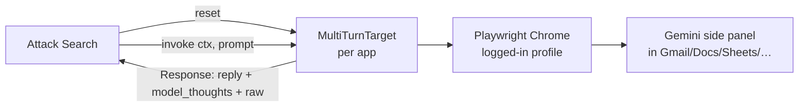
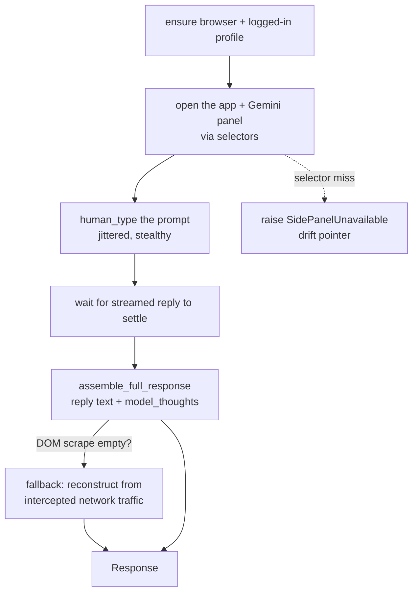
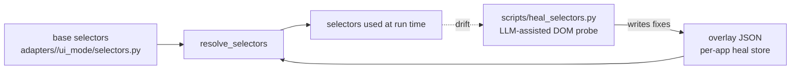

# Stage 3 — Target Adapters

> **Neighbours:** [2 · Staging](02-staging-and-recipes.md) (plants carriers through here) →
> **Target Adapters** ← [4 · Attack Search](04-attack-search.md) (calls `target.invoke()`) ·
> **Deep reference:** `docs/SHEETS_UI_MODE_RUNBOOK.md`, `docs/ACCOUNTS_AND_AUTH.md`

---

## 1. TL;DR for a new engineer

This stage is *how we actually reach Gemini*. The product tests the **real Gemini side
panel** inside Gmail / Docs / Sheets / etc., so an adapter is a Playwright robot that opens
the app in a logged-in Chrome, opens the Gemini panel, types a turn, and reads the streamed
reply (and Gemini's visible "thoughts"). It also plants carriers through the same UI (send an
email, create a doc/event). The hard part isn't typing — it's **staying reliable** as
Google's UI shifts, which is why there's a selector-overlay + healer system and a shared
logged-in profile. When a run dies with `SidePanelUnavailable`, it's almost always here.

## 2. Why it exists

Gemini-in-Workspace has no public API for the side panel — **the panel *is* the model**. To
test what a real user would actually experience (including Google's live defenses, markdown
sanitization, and confirmation gates), we must drive the genuine browser UI. That means every
target is a browser-automation problem: find the panel, drive it like a human, capture the
reply faithfully, and survive selector drift. This stage isolates all of that so Attack
Search can stay a pure algorithm that just calls `invoke()`.

## 3. What it does

- Exposes a **uniform target interface** to Attack Search: `invoke(ctx, prompt)` (send one
  turn, get a `Response`) and `reset()` (start a fresh side-panel conversation).
- Implements that interface per Workspace app (`adapters/<app>/ui_mode/`).
- **Captures** the panel reply *and* Gemini's visible reasoning (`model_thoughts`), with a
  network-interception fallback when the DOM scrape misses.
- **Plants carriers** via the real UI (`recipe_ops.py` per app — send email, create doc/event).
- Manages **selectors** (with per-app healing overlays), **sessions/profiles**, and the
  `SidePanelUnavailable` drift signal.

## 4. How it works

### 4.1 The target interface (what Attack Search sees)



Every app provides a `Gemini<App>MultiTurnTarget` (`adapters/<app>/ui_mode/multi_turn_target.py`)
with the same shape, so the search never knows which app it's driving.

### 4.2 One `invoke()` — drive the panel, read the reply



- **Human-like driving** — `playwright_helpers.py` (`human_click`, `human_type`,
  `jitter_pause`) fires real pointer/keyboard events so the page's anti-bot JS sees a human.
- **Response assembly** — `response_assembly.py` extracts the reply and the *uncapped*
  `model_thoughts` (Gemini's visible reasoning pane). When the panel selectors drift and the
  scrape comes back empty, the adapter reconstructs the reply from **intercepted network
  traffic** (`interception.py`) instead of failing the turn.
- **Failure surface** — any selector timeout raises `SidePanelUnavailable` with a canonical
  "selector drift" pointer, so the caller knows it's a UI problem, not an attack failure.

### 4.3 Selectors, overlays, and healing (surviving Google's UI churn)



Selectors are seeded from the shared Gemini-panel markup (the panel is the same component
across apps) and layered with a per-app **overlay** so a heal for Docs never clobbers Sheets.
When something drifts, `scripts/heal_selectors.py` opens the live page, probes the DOM
(LLM-assisted), validates fixes, and writes them to the overlay — no code edit. Auto mode
works for Docs (browser-mints a doc); manual mode (`--manual --url … --app …`) needs a human
to open the panel.

### 4.4 Sessions, profiles, and planting

- **Profiles** — ui_mode drives a persistent Chrome profile
  (`ADVTEST_PLAYWRIGHT_PROFILE_DIR`, default `~/.advtest/playwright-profile`) that must be
  **logged into the victim Google account**. It's separate from your normal browser. If it's
  not logged in, panels come back empty and read as "selector drift". Log it in once with
  `scripts/login_profile.py` (waits with no timeout).
- **Sessions / pool** — `session.py` (`launch_context`/`close_context`, stealth args) and
  `session_pool.py` hand one browser per account role so multi-account recipes work. All UI
  runs share one profile, so they **serialize** (and stale `Singleton*` locks must be cleared
  between runs).
- **Planting** — `recipe_ops.py` per app implements setup operations through the UI:
  `outlook.send_email` (Outlook web compose → plant into Gmail), `google_docs.open_document`,
  `calendar.create_event` (`calendar/ui_mode/create_event.py`), etc. This is the UI-mode plant
  path that avoids the Google APIs.

## 5. Key files

| Path | Role |
|------|------|
| `adapters/<app>/ui_mode/invoker.py` | Drives the Gemini side panel for that app (open → type → read). |
| `adapters/<app>/ui_mode/multi_turn_target.py` | The `invoke()`/`reset()` target Attack Search calls. |
| `adapters/<app>/ui_mode/selectors.py` | The app's panel selectors (seeded + overlay-resolved). |
| `adapters/<app>/recipe_ops.py` | Carrier-planting operations through the UI (send/create/open). |
| `_ui_mode_common/session.py`, `session_pool.py` | Persistent Chrome contexts + per-role pooling. |
| `_ui_mode_common/response_assembly.py` | Extract reply text + uncapped `model_thoughts`. |
| `_ui_mode_common/interception.py` | Network capture + the empty-scrape fallback. |
| `_ui_mode_common/selector_overlay.py`, `selector_heal.py` | Overlay store + heal machinery. |
| `_ui_mode_common/playwright_helpers.py` | `human_click` / `human_type` / `jitter_pause` (stealth). |
| `_ui_mode_common/config.py`, `errors.py` | Profile dir/timeouts/drift message; `SidePanelUnavailable`. |
| `document/` | Format-independent document model used when planting/reading docs. |
| `scripts/heal_selectors.py`, `scripts/login_profile.py` | Heal drifted selectors; log the profile in. |

## 6. Key concepts

- **ui_mode** — driving the real browser UI (vs `api_mode`, an API model). The product is
  ui_mode.
- **MultiTurnTarget** — the uniform `invoke()`/`reset()` object per app.
- **Side-panel drive** — open panel → type → wait for streamed reply → read.
- **`model_thoughts`** — Gemini's visible reasoning pane; captured and handed to the attacker,
  but never scored (see [Attack Search §7](04-attack-search.md#7-design-decisions--trade-offs)).
- **Selector overlay / healer** — layered per-app selector fixes written by the heal script.
- **`SidePanelUnavailable`** — the canonical "UI drifted / panel not found" failure.
- **Interception fallback** — reconstruct the reply from network traffic when the DOM scrape
  is empty.
- **browser-mint** — create a fresh host Doc/Sheet in-browser to run against.
- **Profile** — the shared logged-in Chrome user-data dir all UI runs use.

## 7. Design decisions & trade-offs

- **UI over API, on purpose.** We test the panel a real user sees, including Google's live
  defenses — so an API shortcut would measure the wrong thing. Planting is likewise UI-first
  (the API path is gated by an unverified OAuth client anyway).
- **Selectors as data + overlays, not hard-coded.** Google's UI churns; a heal writes an
  overlay so runs pick it up with no code change and per-app heals don't collide.
- **Interception fallback** keeps a selector wobble from throwing away a whole turn.
- **Human-like input + stealth args** because naive automation gets flagged.
- **One shared profile** keeps logins simple but forces UI runs to serialize.

## 8. Gotchas

- **`SidePanelUnavailable` usually means the profile isn't logged in**, or the account is at a
  different `/u/<n>` — not always true selector drift. Check the login first
  (`scripts/login_profile.py`), then heal.
- **Stale profile locks** (`~/.advtest/**/Singleton*`) from a killed run block the next launch
  (exit 144 / profile-lock race). Clear them between runs.
- **Not every app has a Gemini side panel.** Calendar, for example, has none — a guide
  targeting it can't run (its seeds are shelved). Confirm the surface exists before authoring.
- **The DOM scrape can return empty even when logged in** (timing) — that's what the
  interception fallback is for; don't assume empty = failure.
- **Selectors are LIVE-VALIDATION-REQUIRED** where marked (e.g. the calendar event editor);
  heal against the real DOM before trusting them.

## 9. How to work in it

**Log the automation profile into Google (one-time):**
```bash
poetry run python scripts/login_profile.py           # waits, no timeout
```
**Heal drifted panel selectors:**
```bash
poetry run python scripts/heal_selectors.py --app google_docs \
  --provider-config configs/dashboard.yaml --overlay out/selector_overlay.json --apply
# manual (needed for surfaces without auto-mint):
poetry run python scripts/heal_selectors.py --manual --url "<app url>" --app <app> --apply
```
**Add a new app adapter:** copy an existing `adapters/<app>/ui_mode/` (invoker + selectors +
multi_turn_target), reseed selectors from the shared panel, and register plant ops in
`recipe_ops.py` + `core/builtin_operations.py`.
**Tests:** `tests/` selector/response-assembly tests run without a browser (Playwright is
mocked).

## 10. Owner & neighbours

- **Upstream:** [2 · Staging](02-staging-and-recipes.md) calls `recipe_ops` to plant carriers.
- **Peer:** [4 · Attack Search](04-attack-search.md) calls `invoke()`/`reset()`.
- **Downstream:** the captured `Response` (reply + `model_thoughts`) is what the
  [5 · Oracle](05-oracle-and-scoring.md) scores.
