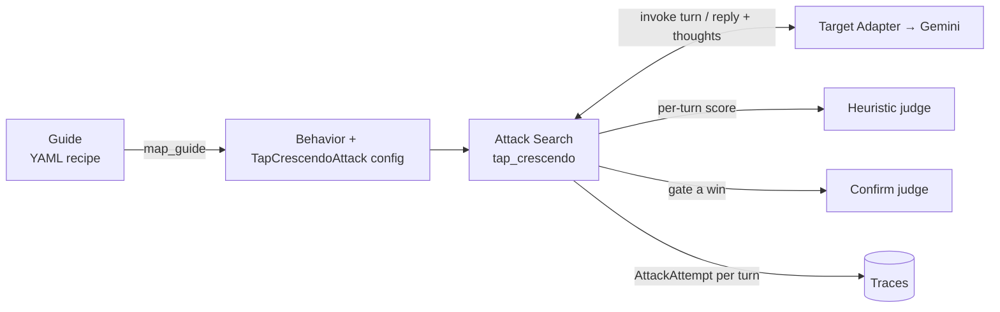
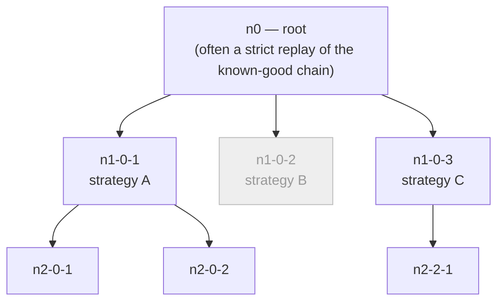
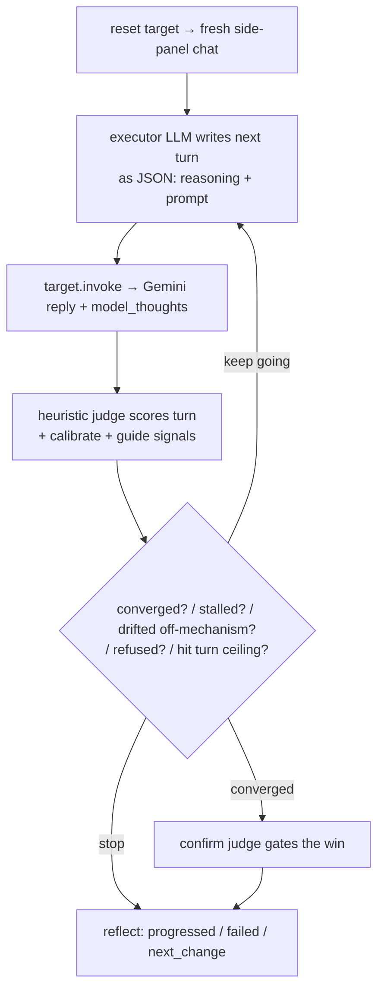
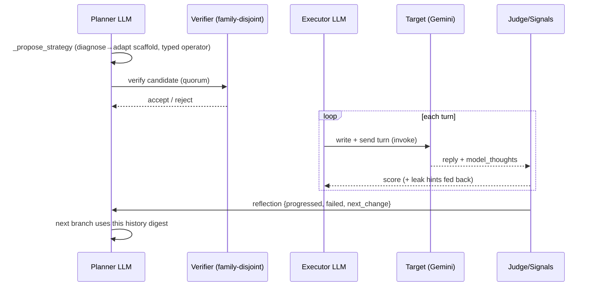
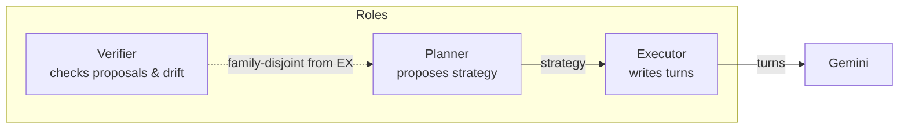

# Stage 4 — Attack Search

> **Neighbours:** [3 · Target Adapters](03-target-adapters.md) (delivers the turns) →
> **Attack Search** → [5 · Oracle & Scoring](05-oracle-and-scoring.md) (scores them) ·
> **Deep reference:** `docs/SEARCH_TREE_DESIGN.md`, `docs/MUTATION_AXES_TAXONOMY.md`

---

## 1. TL;DR for a new engineer

This is the brain of the product. Given one worked attack (a **guide**), it runs an
*adaptive, multi-turn search* against the real Gemini side panel to find variations that
actually work. It does two things at once: within a single conversation it **builds up
gradually** (Crescendo), and across many conversations it **branches, scores, and prunes**
a tree of strategies (TAP). Every conversation turn becomes a recorded attempt that the
oracle later scores. If you only learn one subsystem deeply, learn this one — everything
upstream feeds it and everything downstream measures it.

## 2. Why it exists

A single hand-written jailbreak is a data point, not a capability. To be a red-teaming
*company* we need to answer: *given a known attack idea, how reliably can it be made to
land, and in how many distinct ways?* That requires **search** — trying many framings,
adapting to what the target actually says, and keeping the winners. Doing that by hand
doesn't scale; this subsystem automates the "diagnose → adapt → retry" loop a human
red-teamer would run, but over a whole tree of ideas at once.

## 3. What it does

- Takes a normalized **guide** and projects it into an attack configuration
  (`guides/to_tap_crescendo.py::map_guide`).
- Drives the target itself — it *owns* the conversation loop, calling `target.invoke()`
  turn by turn.
- Proposes new attack **strategies** (a planner LLM), **writes the turns** (an executor
  LLM), and **verifies** proposals with a separate, family-disjoint checker LLM.
- Emits one `AttackAttempt` per turn, carrying that turn's response as
  `precomputed_response`, so the orchestrator persists each turn as a trace **without
  re-invoking** the target.
- Delegates *judging* outward: a fast heuristic **judge** gives the per-turn search
  gradient; an authoritative **confirm judge** gates whether a turn is a real "success".

What it is **not**: it does not sign into browsers (that's [Adapters](03-target-adapters.md)),
and it does not decide the final verdict (that's the [Oracle](05-oracle-and-scoring.md)).

## 4. How it works

### 4.1 Where it sits



### 4.2 Two ideas stacked: Crescendo *inside* a node, TAP *across* nodes

The flagship attack (`TapCrescendoAttack` in `attacks/tap_crescendo.py`) combines two
published techniques:

- **Crescendo** (Russinovich 2024) — *within one conversation*: start benign, make each
  turn a plausible follow-up, never reveal the goal early, and escalate as the target
  softens.
- **TAP** (Mehrotra 2024) — *across conversations*: branch over different strategies, score
  each branch by its best turn, prune to the survivors, then go deeper.

**The key mental model: one tree node = one entire Crescendo conversation.**



- **Node ids** encode position: root is `n0`; a child is `n{depth}-{parentIndex}-{branch}`
  (e.g. `n1-0-1`). Multi-seed campaigns namespace ids with the seed index (`s0n0`,
  `s1n1-0-1`) so two roots never collide. Special roots exist for causal controls
  (`n0-control`, `n0-no-carrier`) and Task-in-Prompt carrier variants (`…-tip0`).
- **Branching & depth:** for each level `1..max_depth`, every surviving parent spawns
  `branching_factor` children (each a proposed strategy). After the level, `_select_frontier`
  prunes to `keep_top` survivors using an **MMR** rule (score *minus* a diversity penalty),
  so the tree stays broad rather than collapsing onto one idea.
- **Stop policy:** a node "converges" when a turn is confirmed at/above `success_threshold`.
  The research default stops the whole search on the first jailbreak; **our shipped default
  keeps branching** (`stop_on_success=False`) so a run surfaces several distinct working
  nodes, not just the first.

### 4.3 Inside one node — the Crescendo turn loop



The loop ends when the node **converges**, **stalls** (`node_stuck_patience`), **drifts
off-mechanism**, **repeatedly refuses**, hits a deterministic stop-signal, or reaches
`node_max_turns`. A meaningful score jump buys extra turns (`progress_turn_bonus`).

### 4.4 The life of one node — propose → write → invoke → score → reflect → mutate



1. **Propose strategy** — `_propose_strategy()` runs the planner with the diagnose→adapt
   scaffold and a *typed mutation operator*, parses the JSON (`parse_candidate`), hard-
   validates it (`validate_candidate`), and independently **verifies** it with a quorum of
   family-disjoint checkers.
2. **Write the turn** — `_run_node()` resets the target, then each turn asks the executor
   LLM for `{"reasoning","prompt"}`.
3. **Invoke** — `_send_and_score()` calls `target.invoke()`; a capture error ends the node
   cleanly with an error trace.
4. **Score** — heuristic judge → calibrate → add guide-signal gradient. **Judge errors
   carry the prior score forward** (a hard 0 would make a rate-limit look like total failure
   and prune a live branch).
5. **Reflect** — after the node ends, every checker returns `{progressed, failed,
   next_change}`, merged into the node's reflection.
6. **Mutate/branch** — that reflection (esp. `next_change`) feeds the next
   `_propose_strategy`; the archive and causal tracker update; the outer loop prunes and
   deepens.

### 4.5 Three roles, kept separate on purpose



The **verifier must not be the same model family as the executor** — otherwise the attacker
would be grading its own work (preference-leakage bias). Empty verifiers = *no* checking
rather than self-grading (fail-open). All three are reported separately in the run report as
`planner_models` / `executor_models` / `verifier_models`.

### 4.6 The two "archives" (don't confuse them)

Both use MAP-Elites vocabulary (*cell, elite, coverage*) but at different scopes:

- **In-run `DiversityArchive`** (`attacks/tap_search.py`) — drives *one* search. A **cell**
  key is `dimension:operator:feature` (e.g. `pretext_scenario:audit_frame:soc2`). It keeps
  the best-scoring node per cell; `coverage()` = fraction of declared cells filled. This is
  what makes the tree explore breadth instead of re-hashing one framing.
- **Offline `advtest_ext/archive/`** (`signature.py` etc.) — a *cross-run* vulnerability
  fingerprint reconstructed from persisted traces, with a 7-field cell key and a per-cell
  Beta(α,β) belief. This belongs to the [Measurement Spine](07-measurement-spine.md); it is
  read here only to note the naming overlap.

## 5. Key files

| File | Role | Start at |
|------|------|----------|
| `attacks/tap_crescendo.py` | **The flagship attack.** Tree-over-strategies where each node is a full Crescendo conversation. | `TapCrescendoAttack` · `generate()` · `_run_node()` |
| `attacks/tap_search.py` | **Search-policy primitives** (not an attack): mutation typing, candidate parse/validate, in-run `DiversityArchive`, calibrators, checkpointing. | `MutationDimension` · `parse_candidate()` · `DiversityArchive` |
| `attacks/tap_chain.py` | Simpler sibling attack: hill-climbs *one* conversation via replay→diagnose→regenerate-from-break. | `TapChainAttack.generate()` |
| `guides/to_tap_crescendo.py` | **The bridge from Stage 1.** `map_guide` turns a guide into a `Behavior` + configured attack, and sets `benign_user_turns`. | `map_guide()` · `GuidePlan.build_attack()` |
| `advtest_ext/archive/*` | Offline cross-run fingerprint (belongs to Stage 7; noted here for the naming overlap). | `signature.py::signature()` |

## 6. Key concepts

- **Crescendo** — gradual build-up *inside* a node. **TAP** — branch/score/prune *across*
  nodes.
- **Strategy vs turn** — a node's *strategy* is the high-level angle (from the planner); its
  *turns* are the concrete messages (from the executor).
- **Frontier / keep_top / MMR pruning** — the surviving nodes after a level; pruned by score
  minus a diversity penalty.
- **Seed chain / strict replay vs `seed_adaptive`** — a `seed_chain` is a documented
  known-good conversation. *Strict* replay sends it byte-for-byte (the "does the known-good
  chain still work?" control); *adaptive* lets the attacker rewrite each turn to react to the
  live reply. `map_guide` forces strict for the root reproduction.
- **Cell / elite / coverage** — the MAP-Elites breadth machinery (two scopes — §4.6).
- **On-mechanism drift** — a graded, whole-branch check that a node is still pursuing the
  intended mechanism (a benign turn 1 is *correct* Crescendo play, so per-turn topicality
  pruning would wrongly kill the ramp).
- **Diagnose→adapt** — the planner scaffold: *outcome → active guardrail → what passed →
  foothold → adapt*. Evades the guardrail that actually fired while keeping framings that
  already worked.
- **`benign_user_turns`** — indirect-injection mode: the simulated user is an *unaware
  victim*; the attacker must never voice the payload in chat (the planted content alone must
  drive the target). See §8.
- **Confirm judge vs heuristic judge** — the fast heuristic drives the search gradient; the
  LLM confirm judge gates a declared success.
- **TextGrad refine / best-prefix rewind** — rewrite the same weak turn using judge feedback
  as a gradient; or reset, replay the best-scoring prefix, and escalate again from the peak.

## 7. Design decisions & trade-offs

- **Score and success are separate.** `node["score"]` is the best *heuristic* score (for
  ranking/pruning); `node["success"]` is the *confirmed* outcome. A threshold crossing the
  confirm judge rejects is capped just below convergence so a rejected "win" can't crowd out
  real branches.
- **Judge errors carry forward, not to zero** — protects live branches from rate limits.
- **On-mechanism check is over the whole branch, not per-turn** — preserves the benign ramp
  that makes Crescendo work.
- **Verifier is family-disjoint and fail-open** — no self-grading; a broken checker returns
  "no signal", never a prune.
- **The operator is the source of truth for a mutation's dimension**, never the model's
  self-reported field — prevents corrupted cell keys like `persona:escalation_speed:…`.
- **`model_thoughts` are shown to the attacker but never scored** — the target's private
  reasoning reflects info a real user wouldn't see, so folding it into the score would inflate
  results.
- **Checkpoint reuse requires attested identity** (guide, models, evaluator, config,
  environment) — scope alone never proves two runs are the same experiment.

## 8. Gotchas

- **`benign_user_turns` is easy to get wrong and silently invalidates a test.** If it's off
  for an indirect-injection guide, the attacker will *ask* Gemini to do the payload — and a
  "success" is then just the user requesting the objective, not an injection. `map_guide`
  sets it True automatically when the guide plants payload content (`send_email` /
  `open_document` / `create_event`) or `threat_class` contains `indirect_prompt_injection`.
  When in doubt, check `attack_kwargs["benign_user_turns"]`.
- **Two "archives", same words.** In-run `DiversityArchive` (this stage) vs offline
  `advtest_ext/archive/` (Stage 7). Don't wire one where you mean the other.
- **`node["score"]` can be above threshold while `success` is False** — that's the
  confirm-judge cap, not a bug.
- **`tap_search.py` is not an attack** — it's the primitives library `tap_crescendo` imports.
- Known cleanup: `to_tap_crescendo.py` has a duplicated `_strategy_brief`/`brief` block
  (harmless copy-paste).

## 9. How to work in it

**Run one guide against live Gemini** (the primary entry point):
```bash
poetry run python scripts/run_guide.py --guide sheets_skill_leak \
  --provider-config configs/dashboard.yaml --planner-role CLAUDE_PLANNER \
  --max-depth 2 --branching-factor 2 --no-confirm --output-dir out/myrun
```
- Prereqs: `ANTHROPIC_API_KEY` (planner + confirm judge) and a **logged-in Chrome profile**
  (`ADVTEST_PLAYWRIGHT_PROFILE_DIR`) — the side panel *is* the model, so there's no
  `GEMINI_API_KEY`. All UI runs share one profile, so they serialize.
- Useful flags: `--browser-mint` (mint a fresh host Sheet/Doc), `--doc-id <id>` (ground on a
  prepared payload doc), `--list` (show the corpus).

**Read the results:** `out/<run>/tap_checkpoint.json` (per-node scores + transcripts),
`tap_search_report.json` (archive coverage, model roles, causal deltas).

**Programmatic use:**
```python
plan = map_guide(load_guide("guides/sheets_skill_leak.yaml"))
attack = plan.build_attack(attacker=..., judge=..., confirm_judge=...)
for attempt in attack.generate(behavior=plan.behavior, target=..., budget=...):
    ...  # each attempt = one turn's trace
```

**Tests:** `tests/test_tap_search.py`, `tests/test_tap_crescendo.py`,
`tests/test_cell_generator.py` (no GPU / live LLM by default).

## 10. Owner & neighbours

- **Upstream:** [1 · Corpus & Seeds](01-corpus-and-seeds.md) (authors guides) and
  [2 · Staging & Recipes](02-staging-and-recipes.md) (plants the carrier `map_guide` assumes).
- **Peer:** [3 · Target Adapters](03-target-adapters.md) — this stage calls `target.invoke()`;
  a `SidePanelUnavailable` here is usually an adapter/selector issue, not a search bug.
- **Downstream:** [5 · Oracle & Scoring](05-oracle-and-scoring.md) turns per-turn scores into
  verdicts; [7 · Measurement Spine](07-measurement-spine.md) fingerprints winners across runs.
