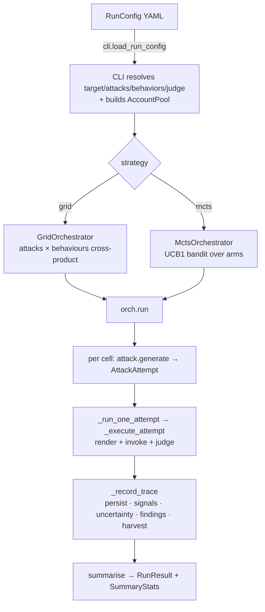
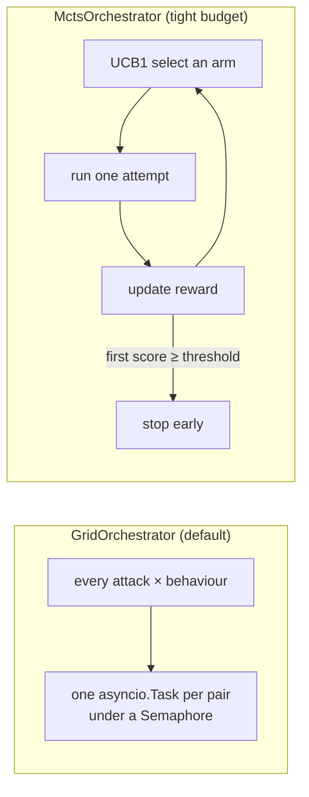
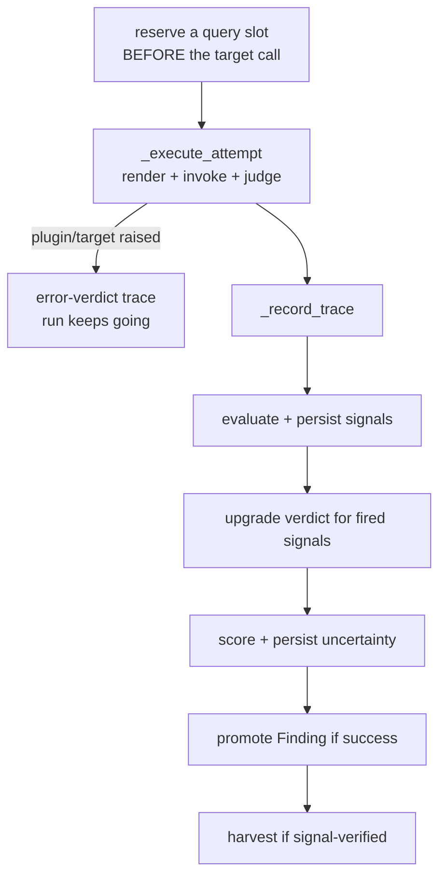

# Stage 6 — Orchestration & Core

> **Owner role:** [Core Platform / Orchestration Engineer](../TEAM.md#2-core-platform--orchestration-engineer) ·
> **Neighbours:** drives [4 · Attack Search](04-attack-search.md), persists to storage,
> feeds [5 · Oracle](05-oracle-and-scoring.md) & [7 · Measurement](07-measurement-spine.md) ·
> **Deep reference:** `docs/CODEBASE_MAP.md`, `core/orchestrator.py` docstring

---

## 1. TL;DR for a new engineer

This is the engine that runs a whole campaign. You describe a **run** in a YAML config (attacks
× behaviours × a target × a judge); the orchestrator executes each cell, isolates errors so one
bad attempt can't crash the run, records every attempt as a **trace**, fires the oracle, promotes
**findings**, and writes everything to storage while the dashboard watches. It's deliberately
*name-free*: it takes already-built objects (an attack plugin, a target, a judge) and just drives
them. Two flavours: `GridOrchestrator` (try everything) and `MctsOrchestrator` (spend a tight
budget wisely).

## 2. Why it exists

Everything else in the system is a component — an attack, an adapter, a judge. Something has to
*compose* them into a repeatable, budgeted, observable run and turn the stream of attempts into a
result with findings. That's this stage. Centralizing the run loop means budgets, error
isolation, persistence, event streaming, and finding-promotion are written **once** and every
attack/target inherits them.

## 3. What it does

- Turns a **`RunConfig`** into an executed set of cells and a **`RunResult`** (+ `SummaryStats`).
- Runs each attempt under **error isolation** (a raising plugin/target becomes an error-verdict
  trace, not a crashed run) and **budget control** (queries/seconds/cost).
- On each trace: evaluates signals, upgrades the verdict, scores uncertainty, promotes findings,
  harvests verified winners.
- Emits **events** the dashboard streams live, and persists to both a JSON sink and a DB sink.

## 4. How it works

### 4.1 Config → run



- A **cell** is one `(attack, behaviour)` pair (Grid cross-product) or one bandit **arm** (Mcts).
  Within a cell, `attack.generate(behavior, target, budget, context)` async-iterates the concrete
  attempts.
- **`Orchestrator.run()`** sets up the target, inits the run in the DB, runs the loop (catching
  `BudgetExceeded`), closes the target, `summarise()`s the traces into a `RunResult`, finalizes
  the DB, recomputes authenticity, and enqueues the review sample.

### 4.2 Grid vs Mcts



- **Grid** — exhaustive; concurrent (`Semaphore(max_concurrency)`); hand-rolls async iteration
  per pair so a generator-internal error isolates to one pair, not the whole run. The benchmark
  default.
- **Mcts** — an AgentVigil-inspired UCB1 bandit over cells; sequential; **stops on the first
  success**. Use it when the query budget is tight and you just want *any* working attack fast.

### 4.3 What happens to each attempt



The query is **reserved before** the target call, so a cap is never exceeded mid-attempt.
`BudgetExceeded` is a control-flow *sentinel*, not an error.

## 5. Key files

| File | Role |
|------|------|
| `core/orchestrator.py` | `Orchestrator` base, `GridOrchestrator`, `MctsOrchestrator`, `run()`, `_run_one_attempt`, `_record_trace`, the event bus. |
| `core/orch_budget.py` | `_BudgetTracker`, `reserve_one_query`, the `BudgetExceeded` sentinel. |
| `core/orch_summary.py` | `summarise()` — folds traces into `SummaryStats` (excludes error verdicts from ASR). |
| `core/orch_trace_meta.py` | `_classify_verdict`, `upgrade_verdict_for_signals`, `run_outcome` trichotomy. |
| `core/models.py` | `RunConfig`, `RunPhase`, `Budget`, `RunResult`, `SummaryStats`, `AttackTrace`, `Verdict`. |
| `core/account_pool.py` | `AccountPool` / `AccountSlot` (shared with [Staging](02-staging-and-recipes.md)). |
| `cli.py` + `_cli_*.py` | Name→object resolution; `_build_orchestrator`, `advtest run`. |
| `storage/` | Persistence (see below). |
| `providers/` | LLM backends behind a uniform surface (see below). |

**Supporting subsystems this stage leans on:**
- **`storage/`** — SQLAlchemy ORM (`Run`, `Trace`, `Finding`, `HitlItem`, `GoldLabel`), a
  session factory (sqlite default, Postgres via `ADVTEST_DB_URL`), repository helpers, a JSONL
  backup sink, and per-finding replay ZIPs.
- **`providers/`** — swap judge/attacker/target model backends by config (`anthropic`,
  `openai`, `gemini`, `local_vllm`), with a `CostLedger` feeding `Budget.max_cost_usd`.

## 6. Key concepts

- **RunConfig / RunPhase / Budget** — the run spec; single- vs multi-phase; query/time/cost caps.
- **Cell / arm** — one `(attack, behaviour)` pair (Grid) or one bandit arm (Mcts). *(Not the same
  as a MAP-Elites diversity cell — see [Attack Search](04-attack-search.md).)*
- **AttackTrace** — one recorded attempt, with hoisted `parent_id`/`depth`, verdict, judge scores.
- **Verdict** — `success | partial | refused | error`; signals only corroborate (up to partial).
- **Error isolation** — a raising component becomes an error trace, never a run abort.
- **`BudgetExceeded`** — a sentinel that ends the loop cleanly, not an exception to fear.
- **Events / event bus** — the live stream the dashboard renders.
- **`run_outcome` trichotomy** — `valid_success / valid_refusal / invalid_technical`; the last is
  excluded from measurement.

## 7. Design decisions & trade-offs

- **Name-free orchestrator.** It consumes resolved objects; the CLI does name→object resolution.
  This keeps the engine testable and decoupled from config specifics.
- **Reserve budget before the call** so caps are honoured exactly, and integrated multi-turn
  attacks pre-reserve their queries.
- **Error verdicts count in `total_traces` but are excluded from ASR denominators** — a crash
  isn't a refusal. The measurement layer further excludes `invalid_technical`.
- **Grid hand-rolls iteration** to isolate per-pair generator failures; the per-pair
  `node_id→trace_id` map is scoped per iteration to avoid cross-linking.
- **Two sinks** — DB (so the dashboard sees rows mid-run) alongside JSONL (grep-friendly backup).
- **Guide runs disable the hard-invariant gate and `stop_on_success`** by default, because the
  gate was rejecting every mutation and killing runs, and we want several nodes per phase.

## 8. Gotchas

- **`stop_on_success` defaults differ by path** — research/Mcts stop on first win; guide runs keep
  exploring to exercise mutation cells.
- **The orchestrator holds the `AccountPool` but doesn't yet pass it into targets** — that wiring
  is the RecipeRunner's job ([Staging](02-staging-and-recipes.md)).
- **"cell" is overloaded** — grid cell/arm here vs MAP-Elites diversity cell in Attack Search.
- **Multi-phase stamps `metadata['phase']`** on every trace — filter by it when reading a
  multi-phase run.
- **DB is sqlite by default** — set `ADVTEST_DB_URL` for Postgres in anything shared.

## 9. How to work in it

**Run a config:**
```bash
poetry run advtest run configs/<run>.yaml
```
**Guide run (the common path for live Gemini):** `scripts/run_guide.py` (wraps
`guides/run.py::run_guide`, which stages then drives a `GridOrchestrator` with a TAP-crescendo
attack).
**Pick the strategy:** `strategy: grid` (default) vs `strategy: mcts` in the config;
`_build_orchestrator` (`cli.py`) selects the class.
**Tests:** `tests/test_orchestrator.py` (main), plus the recipe/account/stage tests.

## 10. Owner & neighbours

- **Owner:** [Core Platform / Orchestration Engineer](../TEAM.md#2-core-platform--orchestration-engineer).
- **Drives:** [4 · Attack Search](04-attack-search.md) (calls `attack.generate`).
- **Feeds:** [5 · Oracle](05-oracle-and-scoring.md) (per-trace scoring),
  [7 · Measurement](07-measurement-spine.md) (uncertainty + review sample),
  [8 · Dashboard](08-dashboard.md) (events + DB rows),
  [9 · Delivery](09-delivery.md) (stored traces/findings).
