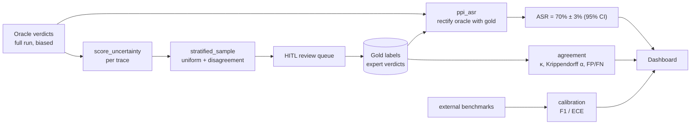
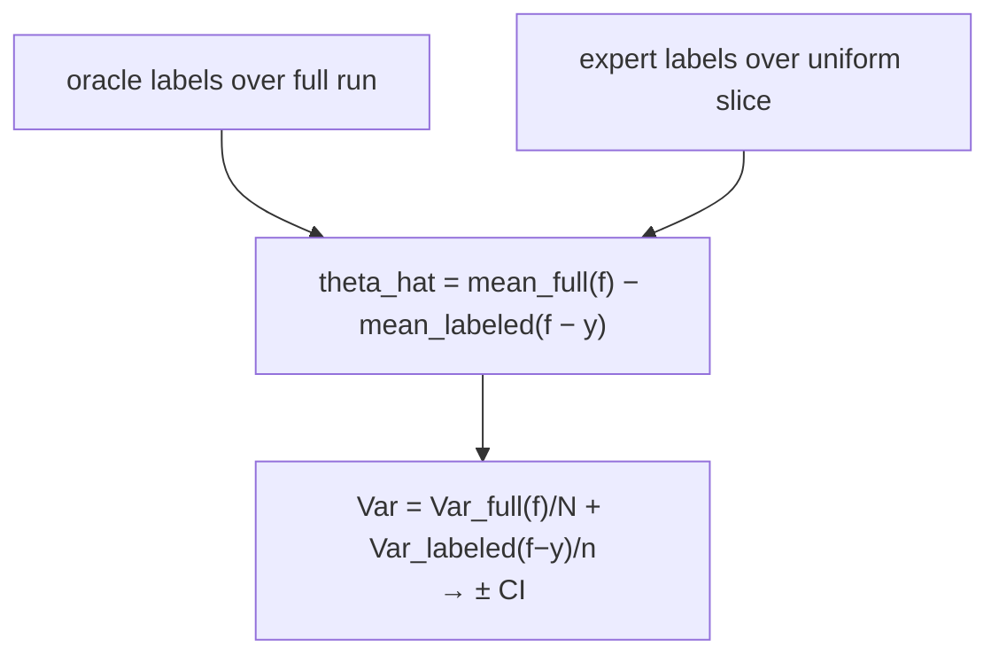

# Stage 7 — Measurement Spine

> **Neighbours:** [5 · Oracle](05-oracle-and-scoring.md) (labels every attempt) →
> **Measurement Spine** → [8 · Dashboard](08-dashboard.md) (shows the numbers) ·
> **Deep reference:** `docs/FISSION_MEASUREMENT_SPINE.md`

---

## 1. TL;DR for a new engineer

The oracle labels every attempt cheaply — but it's biased (it makes false positives and
negatives). This stage turns those biased per-attempt labels into a **trustworthy run-level
Attack-Success-Rate with an honest confidence interval**, *plus* the numbers that say how much
to trust the oracle itself. It does this by having a human review a small, statistically-chosen
slice, then using **prediction-powered inference (PPI)** to correct the oracle's bias. This is
what lets us say "ASR = 70% ± 3%" and mean it. It's all pure-stdlib statistics — no numpy/scipy.

## 2. Why it exists

"The oracle said 42 of 60 succeeded" is not a defensible number — the oracle is wrong some of
the time, and we don't know how often unless we measure it. A red-teaming report needs a rate
*with* a confidence interval, and a claim about *how reliable the grader is*. Doing that
without labelling everything by hand requires a principled way to combine a cheap-but-biased
full-run label set with a small expert-labelled sample. That's exactly what this stage is.

## 3. What it does

- Scores **per-trace uncertainty** (how much a human should prioritize reviewing this one).
- Draws a **stratified sample** (a uniform slice + a disagreement slice) into the human review
  (HITL) queue.
- Turns expert labels (the **gold set**) into **PPI ASR ± CI**.
- Computes **inter-rater agreement** (oracle vs experts, and the human ceiling).
- Computes **oracle calibration** (F1 / ECE) against externally-labelled benchmarks.

## 4. How it works

### 4.1 The flow



### 4.2 Which traces a human reviews (and why it's two slices)

`stratified_sample` draws **two disjoint slices**, and the *order matters*:

1. **Uniform slice first** — a simple random sample of the whole run. This is the
   **load-bearing, unbiased** slice; PPI's bias correction is only valid over *this*.
2. **Disagreement slice** — the top-K most *uncertain* traces from the remainder.

`score_uncertainty` prioritizes on three axes (in strict order):
- **L0↔L2 conflict** — a signal fired but the judge scored below threshold (one-sided: a
  *non*-fired signal is not proof of refusal) → highest priority.
- **Uncorroborated judge success** — judge says success, but no signal corroborated it.
- **Near-threshold** — the score sits right at the decision boundary.

### 4.3 PPI — the honest ASR



`ppi_asr` combines the oracle's label over the *whole* run with the small expert slice: the
**rectifier** `(f − y)` corrects the oracle's average bias, and the CI accounts for both the
run size `N` and the oracle's reliability `n`. If there are no labels yet, it falls back to
`oracle_only` (an honest point estimate with an uncalibrated CI — the UI says "collect labels").

### 4.4 How much to trust the oracle

- **Cohen's κ** — oracle vs the expert consensus, chance-corrected.
- **Krippendorff's α** among the experts — the **ceiling**: an oracle can't be more reliable
  than the humans it's scored against.
- **FP / FN rates**, each with a **Wilson interval** (Wilson because at n≈100–300 with few
  positives the normal approximation leaves [0,1]).
- **ECE (expected calibration error)** — are the oracle's confidence scores honest?

Calibration is scored against **expert / externally-labelled ground truth, never the oracle's
own verdict** — that's what keeps the fit honest.

## 5. Key files

| File | Role |
|------|------|
| `core/uncertainty.py` | `score_uncertainty` → per-trace review priority (`Uncertainty`). |
| `core/sampling.py` | `stratified_sample` (uniform + disagreement slices). |
| `core/ppi.py` | `ppi_asr` (pure estimator) + `ppi_asr_for_run` (DB glue) → `PpiEstimate`. |
| `core/agreement.py` | `cohen_kappa`, `krippendorff_alpha`, `wilson_interval`, `error_rates`, `build_agreement_report`. |
| `calibration/` | External calibration datasets: `datasets.py`, `ingest.py`. |
| `core/calibration_report.py` | `build_calibration_report`, `compute_metrics`, `expected_calibration_error`. |
| `core/orch_trace_meta.py` | `run_outcome` trichotomy (`valid_success/valid_refusal/invalid_technical`). |
| `advtest_ext/archive/` | The offline cross-run vulnerability fingerprint (Beta posteriors, drift) — an alternative offline input, mapped in [Attack Search §4.6](04-attack-search.md#46-the-two-archives-dont-confuse-them). |

## 6. Key concepts

- **PPI (prediction-powered inference)** — combine a cheap biased full-run label set with a
  small unbiased expert slice; the rectifier corrects bias, the CI reflects both.
- **Stratified sampling** — uniform (unbiased, load-bearing) + disagreement (uncertainty-
  targeted). Uniform is drawn *first* so it stays a genuine random sample.
- **Gold set / HITL** — expert-labelled traces, each carrying the oracle's *frozen* prediction.
- **Cohen's κ / Krippendorff's α / Wilson interval** — oracle-vs-human agreement, the human
  ceiling, and small-n-safe rate intervals.
- **ECE** — whether the oracle's confidence is honest.
- **`run_outcome` trichotomy** — `invalid_technical` (bot-detected / selector-drift / judge
  error) must never enter an ASR or posterior.

## 7. Design decisions & trade-offs

- **PPI is only valid over the uniform slice.** The disagreement slice is deliberately skewed
  to hard cases, so using it in the rectifier would bias the estimate; the sampler draws uniform
  first precisely to protect this.
- **Uncertainty conflict is one-sided.** Only "signal fired yet judge said not-success" is a
  real conflict — a missing marker isn't a refusal.
- **Agreement is scored against the oracle's *frozen* prediction**, so it always measures the
  predictor that actually labelled the trace; consensus ties break to the *less severe* verdict
  so a split panel never manufactures a success.
- **Small-n honesty** — Wilson over Wald; empty states instead of a misleading `0.0%`.
- **Dependency-free by design** — stdlib only (`statistics`, `random`), so every estimator is
  unit-testable without a DB or a model.
- **Calibration ingest fails closed** — an unrecognised label *raises* rather than being
  silently coerced into a verdict the numbers would then trust.

## 8. Gotchas

- **Don't feed `invalid_technical` traces into a rate.** A selector-drift failure is not a
  refusal; filter with `run_outcome` first.
- **`oracle_only` is not a calibrated CI** — it's the no-labels fallback; the interval is
  honest but wide, and the UI should prompt for labels.
- **Never calibrate against the oracle's own verdict** — use `GoldLabel.expert_verdict` /
  external benchmarks, or the fit is circular.
- **FP/FN denominators differ** — FP is over predicted-positives, FN over actual-positives, not
  the gold-set size.
- **Two meanings of "cell"** — the MAP-Elites diversity cell (Attack Search) vs a run grid cell
  (Orchestration). Neither is the measurement gold set.

## 9. How to work in it

**Run the whole spine offline (real components, faked model):**
```bash
poetry run python scripts/spine_e2e.py
# orchestrator → uncertainty → sampler → simulated review → gold set → PPI ASR±CI → F1/ECE
```
**Calibrate the TAP search's judge/partial calibrators from the gold set:**
```bash
poetry run advtest calibrate   # writes judge_calibration.json / partial_signal_calibration.json
```
**Calibration dataset loop:** `scripts/ingest_calibration.py` (JSONL → rows; `--list` shows
ingestable sets) → `scripts/run_calibration.py` (runs the judge over examples — real API calls)
→ dashboard `/calibration`.
**Tests:** `tests/test_ppi.py`, `tests/test_sampling.py`, `tests/test_uncertainty.py`,
`tests/test_agreement.py`, `tests/test_calibration*.py`.

## 10. Owner & neighbours

- **Upstream:** [5 · Oracle](05-oracle-and-scoring.md) produces the verdicts + uncertainty this
  stage consumes; [6 · Orchestration](06-orchestration-and-core.md) enqueues the review sample.
- **Downstream:** [8 · Dashboard](08-dashboard.md) renders ASR ± CI and the judge-quality panel;
  [9 · Delivery](09-delivery.md) reports only what was measured.
