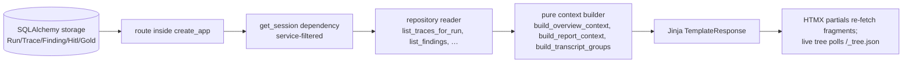
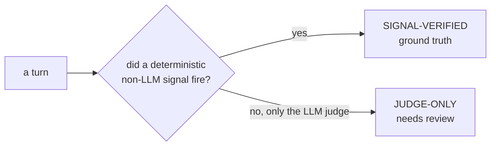

# Stage 8 — Dashboard

> **Owner role:** [Product Engineer (Dashboard)](../TEAM.md#6-product-engineer-dashboard) ·
> **Neighbours:** reads storage (written by [6 · Orchestration](06-orchestration-and-core.md)),
> renders [5 · Oracle](05-oracle-and-scoring.md) verdicts & [7 · Measurement](07-measurement-spine.md) ASR ·
> **Deep reference:** `docs/INTEGRATION_CONTRACT.md`, `docs/GETTING_STARTED.md`

---

## 1. TL;DR for a new engineer

The dashboard is the operator's window onto everything: it reads the persisted runs / traces /
findings and renders them as HTML, and it's also the **launcher** — you can start a live attack
run from the UI and watch it progress turn by turn. It's a single **FastAPI + Jinja2 + HTMX** app
(explicitly *not* React). One quirk to know before you touch it: almost every route is a closure
defined *inside* one big `create_app()` factory, so to find a route you search inside that
function, not at module top level.

## 2. Why it exists

A run produces hundreds of traces and a handful of findings in a database — useless until a human
can see them. The dashboard makes campaigns legible (attack trees, transcripts, heatmaps, ASR with
confidence), lets an operator launch and supervise live tests without the CLI, and produces the
client-facing reports. It's the product surface the rest of the system exists to feed.

## 3. What it does

- **Reads** storage and renders pages + HTMX partials (overview, runs, findings, surfaces, seeds,
  playbooks, HITL, calibration, drift).
- **Launches & supervises live runs** as child subprocesses (`LiveTestController`) that stream
  traces into the same DB, which the UI polls for near-real-time progress and a live attack tree.
- **Renders transcripts** — reconstructs per-turn traces (crescendo / tap_chain) into readable
  conversations.
- **Generates client reports** — HTML always, plus PDF/DOCX when the optional libraries are present.

## 4. How it works

### 4.1 Read path



### 4.2 Live run path

```mermaid
flowchart TD
    UI[POST /live-tests/{id}/start<br/>confirmed:true] --> LC[LiveTestController]
    LC --> PRE[_precreate_run_row<br/>so /runs/id doesn't 404]
    LC --> SP[spawn run subprocess]
    SP --> DBW[(writes traces into the same DB)]
    UI2[/live-tests/progress polls] --> DBW
    UI3[/runs/id/_tree.json polls ~2s] --> DBW
    LC -->|queue| Q[start_batch runs back-to-back]
```

- The `LiveTestController` runs an **allow-listed** set of workflows, one at a time, and can queue
  several (`start_batch`). It pre-creates the Run row synchronously so the run page doesn't 404
  during the 30–60s staging window, and converts raw runner stdout into vendor-neutral,
  customer-facing event strings.
- **Progress** (`/live-tests/progress`) reads the active run's rows and shows per-turn verdict,
  judge score, and which signals fired — including the **SIGNAL-VERIFIED vs JUDGE-ONLY** badge.

### 4.3 SIGNAL-VERIFIED vs JUDGE-ONLY



This is the UI surfacing the [Oracle's](05-oracle-and-scoring.md) core discipline: a
deterministic signal is trustworthy provenance; a judge-only call is a candidate for the
[HITL review queue](07-measurement-spine.md). The same distinction gates which winners get
"banked" as variants.

### 4.4 The live attack tree

Three routes back the tree, all through the same builder so they never drift: `/_tree` (a
server-rendered structural fallback), `/_panel` (interactive slide-over), and **`/_tree.json`**
(the live feed — a Cytoscape graph the client polls ~every 2s and diffs, adding only new nodes).

## 5. Key files

| File | Role |
|------|------|
| `dashboard/app.py` | The **monolithic factory** `create_app()` — nearly every route is a closure inside it; auth middleware; Jinja globals; `get_session`. |
| `dashboard/live_tests.py` | `LiveTestController` — launch/queue/stop live run subprocesses; the allow-list catalogue; vendor-neutral event strings. |
| `dashboard/services.py` | Service (Gemini/OpenAI/Claude) filtering; `target_identity`, `scope_campaign_reads`, `group_surfaces`. |
| `dashboard/report.py` | Report context assembly (`build_report_context`, `build_findings_report_context`) + `render_pdf` (WeasyPrint). |
| `dashboard/transcript.py` | Pure conversation reconstruction (`build_transcript_groups`, `ConversationGroup`); rendered-DOM-over-intercepted display choice. |
| `dashboard/templates/` | Jinja templates; `_`-prefixed = HTMX partials; `runs/`, `findings/`, `reports/`, `seeds/`, `playbooks/`, `surfaces/`, `target_drift/`, `traces/`. |

## 6. Key concepts

- **`create_app()` factory** — routes are closures inside it; run with `uvicorn … --factory`.
- **HTMX partials (`_`-prefixed)** — fragments re-fetched via `hx-get`/`hx-trigger`. Usage is
  light; the live tree and live-tests screen use plain `fetch()` polling instead. So: *HTMX for
  fragments + vanilla-JS for live polling*, not pure HTMX.
- **LiveTestController / live run queue** — allow-listed workflows launched as subprocesses,
  queued via `start_batch`, streaming into the shared DB.
- **SIGNAL-VERIFIED vs JUDGE-ONLY** — deterministic-signal provenance vs judge-only.
- **Service filter** — a presentation filter (cookie `fission-service`) applied to *all*
  collection reads via a SQLAlchemy loader-criteria listener (read-only, never mutates rows).
- **Playbooks / seeds / variants** — guide files surfaced as scenarios; only signal-verified wins
  are banked as variants.
- **Live tree (`/_tree.json`)** — Cytoscape graph, client-side diffing.

## 7. Design decisions & trade-offs

- **Monolithic factory over routers** — nearly all routes live in `create_app` (only the
  target-drift router is separate). Trade-off: everything's in one place, but it's a big file —
  search inside `create_app`.
- **`get_session` closes in `finally`** — an earlier GC-based close exhausted the pool under
  several HTMX pollers at 2–3s; explicit close was required.
- **Run-row pre-creation** so the run page doesn't 404 during staging.
- **Optional PDF deps degrade to HTTP 501 with an install hint**, never a crash (WeasyPrint for
  the run report, reportlab for the transcript report).
- **Vendor-neutral event strings** — the operator console never shows raw internals/tracebacks.
- **`.env` read at launch time** — rotating a key needs no dashboard restart.

## 8. Gotchas

- **Routes are inside `create_app` (`app.py`), not at module top level** — don't grep the module
  scope.
- **Route order matters** — `/live-tests/batch/start` is registered *before*
  `/live-tests/{test_id}/start` so "batch" isn't parsed as a test id.
- **Two "drift" concepts** — operational routes vs target-version drift under `/target_drift`.
- **Live launching is gated** — `ADVTEST_ENABLE_LIVE_TESTS=1` (plus the relevant API keys) or the
  start routes refuse.
- **Transcript display prefers the rendered DOM capture** over the intercepted stream; divergent
  intercepted text is not appended (so don't expect it in the transcript).
- **The client PDF reports live here, not in [Delivery](09-delivery.md)** — Delivery emits the JSON
  dataset; the dashboard renders the disclosure/transcript PDFs.

## 9. How to work in it

**Run the server:**
```bash
poetry run uvicorn "advtest_ext.dashboard:create_app" --factory --port 8000
```
- DB from `ADVTEST_DB_URL` (sqlite default). Optional auth via `ADVTEST_DASHBOARD_TOKEN`.
- To launch runs from the UI: `ADVTEST_ENABLE_LIVE_TESTS=1` + `ANTHROPIC_API_KEY`.

**Launch a run from the UI:** POST `/live-tests/{test_id}/start` (or `/live-tests/batch/start`)
with `confirmed: true`; the guided path takes `playbook`, `branching_factor` (1–5), `max_depth`
(1–12), `max_nodes_per_seed` (≤400).
**Add a page:** add a route closure inside `create_app`, a repository reader, a pure context
builder, and a Jinja template (partials `_`-prefixed).

## 10. Owner & neighbours

- **Owner:** [Product Engineer (Dashboard)](../TEAM.md#6-product-engineer-dashboard).
- **Upstream:** [6 · Orchestration](06-orchestration-and-core.md) writes the rows (and, for live
  runs, the launched subprocess streams them).
- **Renders:** [5 · Oracle](05-oracle-and-scoring.md) verdicts/badges and
  [7 · Measurement](07-measurement-spine.md) ASR ± CI / judge-quality.
- **Sibling:** [9 · Delivery](09-delivery.md) — shares the report layout; Delivery emits JSON, the
  dashboard emits the PDFs.
