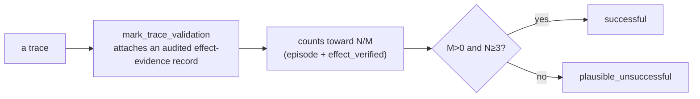

# Stage 9 — Delivery

> **Owner role:** [Delivery & Reporting Engineer](../TEAM.md#7-delivery--reporting-engineer) ·
> **Neighbours:** reads storage (findings/traces) written by
> [6 · Orchestration](06-orchestration-and-core.md); shares report layout with
> [8 · Dashboard](08-dashboard.md) · **Deep reference:** `docs/PILOT_DELIVERY_FORMAT.md`

---

## 1. TL;DR for a new engineer

Delivery folds a set of runs into the **client deliverable** — the exact per-attack JSON dataset
handed to the customer (the Workspace IPI pilot format). It reads the stored traces, groups them
into distinct attacks, works out each attack's real success rate from *validated* episodes,
classifies its harm, resolves the user journey it triggers, and emits a single validated
`PilotDataset` JSON. Two things to know up front: (1) the deliverable is **JSON, not PDF** (the
client PDFs live in the [Dashboard](08-dashboard.md)); (2) an attack only counts as *successful*
if a human explicitly **validated** it — search traces alone are just "discovery evidence."

## 2. Why it exists

A pile of traces isn't a deliverable. The client wants a structured, standards-tagged record of
each distinct attack: its payload, the exact attack string, how reliably it works (N trials / M
successes), what harm it causes, and which real user journey it hijacks — in a stable schema they
can ingest. Delivery is the pure transformation from "what we ran" to "what we hand over," with
the discipline that only verified effects are reported as successes.

## 3. What it does

- **Groups** stored traces into distinct attacks (validated candidate+environment, or a
  discovery hash).
- **Computes N/M** from explicit validation episodes (each episode counts once, regardless of
  turns; a success needs `verdict=="success"` *and* `effect_verified`).
- **Classifies** each attack: outcome (successful / plausible / dropped), harm type + severity,
  the user journey it triggers, and the decomposed judge verdict.
- **Tags** every attack with OWASP / MITRE-ATLAS / Promptware standards.
- **Emits** a validated `PilotDataset` and serializes it to JSON.

## 4. How it works

### 4.1 Trace rows → client JSON

```mermaid
flowchart TD
    DB[(Trace + Finding rows)] -->|build_dataset_for_runs| LOAD[load traces + guides + finding severities]
    LOAD -->|build_dataset_from_traces PURE| GRP[group traces → _Group]
    GRP --> BA[_build_attack per group]
    BA --> NM[N/M from validation episodes]
    BA --> OUT[outcome: successful / plausible / dropped]
    BA --> HARM[classify_harm + severity + standards tags]
    BA --> JRN[resolve_journey]
    BA --> DEC[parse decomposed verdict]
    NM & OUT & HARM & JRN & DEC --> PA[PilotAttack]
    PA --> DS[PilotDataset<br/>successful[] + plausible_unsuccessful[] + journeys + counts]
    DS --> JSON[model_dump → pilot_dataset.json]
```

- **Pure/impure split:** `build_dataset_for_runs` does the DB I/O; `build_dataset_from_traces` is
  a **pure** function (unit-testable with in-memory stand-ins).
- **Outcome:** *successful* when `M>0` and `N ≥ min_validation_trials` (default 3); *plausible*
  when engaged (a partial verdict or score ≥ the plausibility floor, 0.15); otherwise dropped
  (hard refusals, unless `--include-hard-refusals`).
- **Representative trace:** prefer effect-verified successes → successes → all; highest judge
  score wins. Its payload + verbatim attack string go into the record.

### 4.2 The validation gate (why "successful" is earned)



`mark_trace_validation` records a reviewed validation episode on the trace **without changing its
verdict** (audit-safe, idempotent, refuses to overwrite a differing record). This is the delivery
counterpart to the dashboard's SIGNAL-VERIFIED badge — `effect_verified` is the delivery notion of
ground truth.

### 4.3 The deliverable schema

`PilotDataset` (pydantic, `extra="forbid"`) is the envelope: `schema_version`, the source run ids,
the referenced subset of the **journey catalogue** inline, the **harm-taxonomy** legend, `counts`,
and two arrays — `successful` and `plausible_unsuccessful`. Each `PilotAttack` maps 1:1 to the
brief's numbered fields (payload, attack string, journey, success rate, metadata…).

## 5. Key files

| File | Role |
|------|------|
| `delivery/export.py` | Entry points `build_dataset_for_runs` (DB) + `build_dataset_from_traces` (pure); grouping, N/M, representative selection, `_build_attack`. |
| `delivery/schema.py` | The pydantic deliverable: `PilotDataset`, `PilotAttack`, `PoisonedPayload`, `SuccessRate`, `AttackMetadata`, `DatasetCounts` (+ field→brief mapping). |
| `delivery/harm_taxonomy.py` | `classify_harm` + the pilot harm types, severities, OWASP/ATLAS/Promptware tags. |
| `delivery/journeys.py` | `JOURNEY_CATALOGUE` + `resolve_journey` (guide app/surface authoritative, else target match, else `J-TOOLUSE-AGENT`). |
| `delivery/validation.py` | `mark_trace_validation` — the audit-safe effect-evidence recorder. |
| `scripts/export_pilot_dataset.py` | CLI wrapper → JSON file. |
| `scripts/mark_pilot_validation.py` | CLI to mark validation episodes before export. |

## 6. Key concepts

- **PilotDataset / PilotAttack** — the envelope and the per-attack record (1:1 with the brief).
- **Unit of delivery** — a candidate in *one* target + environment; search traces are discovery
  evidence, not deliverables.
- **N / M** — trials / successes, computed only from explicit validation episodes; multiple turns
  in one episode count once.
- **`effect_verified`** — the delivery ground-truth flag; the counterpart to SIGNAL-VERIFIED.
- **Outcome** — successful / plausible_unsuccessful / dropped.
- **Two payload shapes** — `injected_content` (the payload text carries the injection) vs
  `multi_turn_conversation` (a crescendo; canonical turns from the guide's `exemplar_turns`).
- **Standards tags** — every attack carries OWASP LLM01, MITRE ATLAS, and a Promptware Workspace
  taxonomy tag (the brief rewards this).
- **`schema_version`** — lets the format evolve without silently changing meaning.

## 7. Design decisions & trade-offs

- **Only validated effects are "successful."** Search discovery is evidence; a human must mark an
  effect-verified episode before it counts — this keeps the deliverable honest.
- **Pure/impure split** for testability (`build_dataset_from_traces` has no DB).
- **Discovery traces group by a run-scoped artifact hash** so unrelated candidates don't pool
  together.
- **Severity is the *more severe* of the harm-type default and any promoted-finding severity** — a
  critical harm type isn't flattened, and an explicit high finding still wins.
- **`classify_harm` is conservative** — an unmatched attack gets `unspecified` + a rationale (and
  the CLI counts these for manual tagging) rather than a confident wrong label.
- **A journey id is always resolvable** (falls back to `J-TOOLUSE-AGENT`) so no record dangles.

## 8. Gotchas

- **The deliverable is JSON — there is no reportlab/PDF here.** The client PDFs (WeasyPrint
  disclosure report, reportlab transcript report) live in the [Dashboard](08-dashboard.md).
  `scripts/create_pilot_pdf.py` is a separate *sales/proposal* PDF, unrelated to this dataset.
- **Un-validated attacks land in `plausible_unsuccessful`, not `successful`** — if a real win is
  missing from `successful`, you probably forgot `mark_pilot_validation`.
- **Multi-turn per-turn traces carry no trial linkage**, so the canonical conversation comes from
  the guide's `exemplar_turns`; chain-walk / single-turn are weaker fallbacks.
- **`min_validation_trials` must be ≥1** or it raises.
- **`mark_trace_validation` never changes the verdict** and refuses to silently overwrite a
  differing prior record (audit safety).

## 9. How to work in it

**Produce an export:**
```bash
# 1) mark the validated episodes first (so they count as successes)
poetry run python scripts/mark_pilot_validation.py --trace <id> ...
# 2) export
poetry run python scripts/export_pilot_dataset.py --all-runs --out pilot_dataset.json
#    or specific runs:
poetry run python scripts/export_pilot_dataset.py --run <run-id> --out pilot_dataset.json
```
Flags: `--guides-dir` (harm/journey enrichment), `--plausibility-floor` (default 0.15),
`--include-hard-refusals`, `--db-url`. The script prints run/attack/harm/severity/journey
distributions and warns on `unspecified` harm types needing manual tagging.
**Tests:** `tests/` delivery tests exercise the pure builder with in-memory trace stand-ins.

## 10. Owner & neighbours

- **Owner:** [Delivery & Reporting Engineer](../TEAM.md#7-delivery--reporting-engineer).
- **Upstream:** [6 · Orchestration](06-orchestration-and-core.md) persists the traces/findings;
  [5 · Oracle](05-oracle-and-scoring.md) supplies the verdicts/decomposition this reads.
- **Sibling:** [8 · Dashboard](08-dashboard.md) renders the client-facing PDFs and shares the
  report layout.
