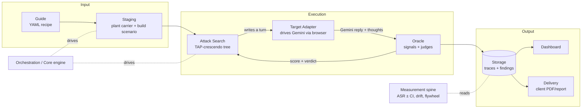

# Fission Architecture — Onboarding Guide

> **New here? Start with this page.** It is the canonical map of the system for
> someone joining the team with no prior context. Each **stage** below has its own
> deep-dive doc that explains *why* it exists, *what* it does, *how* it works, with
> diagrams. The companion [TEAM.md](../TEAM.md) shows who would own each stage if we
> were a full team, and which files are theirs.
>
> This set supersedes the scattered older docs as the *entry point*. The older docs
> (e.g. `CODEBASE_MAP.md`, `FISSION_HLD.md`, `FISSION_ARCHITECTURE_AND_PRODUCTION.md`)
> remain as reference/deep-dives and are linked from the relevant stage.

---

## What is Fission, in one paragraph

Fission is a **red-teaming platform for Gemini in Google Workspace**. It tests whether
Gemini — in Gmail, Docs, Sheets, etc. — can be tricked by **indirect prompt injection**
into leaking data, revealing its own instructions, or taking unauthorised actions. You
describe an attack once as a reusable **guide**; the platform **stages** it into a live
scenario (planting a poisoned email/doc), drives the real **Gemini side panel** through a
browser, runs a **search** over many attack variations, and a multi-layer **oracle** scores
whether each attempt actually succeeded. Results are stored, shown in a **dashboard**, and
packaged into client **deliverables**.

## The pipeline (how a run flows)

> Read the diagram as: a **guide** becomes a staged **scenario**; the **attack search**
> proposes attack turns; each turn is delivered to real **Gemini** by an **adapter**; the
> **oracle** scores the reply and feeds the score back so the search can adapt and branch;
> everything lands in **storage** for the **dashboard**, **delivery**, and **measurement**.

## The stages (deep-dive docs)

Read them in this order for a full mental model. Each links to its owning role in
[TEAM.md](../TEAM.md).

| # | Stage | What it answers | Doc | Owner role |
|---|-------|-----------------|-----|-----------|
| 1 | **Corpus & Seeds** | What attacks do we test? | `01-corpus-and-seeds.md` | Corpus & Seeds Engineer |
| 2 | **Staging & Recipes** | How does a guide become a live, planted scenario? | `02-staging-and-recipes.md` | Core Platform Engineer |
| 3 | **Target Adapters** | How do we drive real Gemini in a browser? | `03-target-adapters.md` | Browser-Automation Engineer |
| 4 | **Attack Search** | How do we find attacks that work? | `04-attack-search.md` | Attack-Search Engineer |
| 5 | **Oracle & Scoring** | Did the attack actually succeed? | `05-oracle-and-scoring.md` | Oracle & Measurement Scientist |
| 6 | **Orchestration & Core** | How is a whole run driven and stored? | `06-orchestration-and-core.md` | Core Platform Engineer |
| 7 | **Measurement Spine** | How do we report ASR with confidence, and learn over time? | `07-measurement-spine.md` | Oracle & Measurement Scientist |
| 8 | **Dashboard** | How do people see and launch runs? | `08-dashboard.md` | Product Engineer |
| 9 | **Delivery** | How do results become the client deliverable (JSON dataset)? | `09-delivery.md` | Delivery & Reporting Engineer |

All nine stage docs follow the same 10-part template (below), so once you've read one you can
navigate any of them.

## How each stage doc is structured (the template)

Every `NN-*.md` follows the same shape, so once you've read one you know how to read them all:

1. **TL;DR for a new engineer** — plain English, 3–4 sentences.
2. **Why it exists** — the problem this stage solves.
3. **What it does** — its responsibilities and boundaries.
4. **How it works** — architecture + flow, with Mermaid diagrams.
5. **Key files** — the file map, each with its role and entry points.
6. **Key concepts** — the vocabulary you must learn.
7. **Design decisions & trade-offs** — why it's built this way.
8. **Gotchas** — footguns and non-obvious behaviour.
9. **How to work in it** — run it, test it, extend it (runnable commands).
10. **Owner & neighbours** — the TEAM.md role and the adjacent stages.

## New-hire reading path

1. This page (the pipeline + mental model).
2. [TEAM.md](../TEAM.md) — see the whole system as owned components.
3. Stages 1 → 9 in order. If you own a stage, read yours twice and its two neighbours once.
4. Then `docs/GETTING_STARTED.md` (run your first attack) and `docs/ACCOUNTS_AND_AUTH.md` (sign in).
