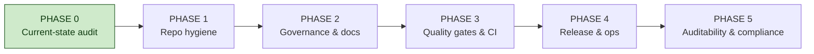

# Fission — Productionisation Plan

> Goal: make the **repository** production-grade — clean, auditable, and safe to hand
> to a reviewer, a new engineer, or a client. This is a *repo/operations* track, not
> a product-capability track. The product roadmap (measurement spine → flywheel →
> scale) lives in [`../FISSION_ROADMAP.md`](../FISSION_ROADMAP.md) and is unchanged by
> this plan; the two run in parallel.

## Why a separate track

The codebase is capable and well-tested (198 package modules, 80 test files, green CI on
3.11/3.12). What is *not* yet production-grade is the state **around** the code: a large
uncommitted working tree, root-level clutter, missing governance files (LICENSE, SECURITY,
CONTRIBUTING), README drift, no release process, and no explicit handling policy for the
adversarial seed content the repo carries. Those are the gaps this plan closes.

"Auditable" here means a reviewer can answer, from the repo alone: what is this, who may
use it, what changed and why, how do I reproduce a result, and where does the sensitive
content live and how is it governed.

## Phase map

| Phase | File | Objective | Exit gate |
|---|---|---|---|
| 0 | [PHASE_0_CURRENT_STATE_AUDIT.md](PHASE_0_CURRENT_STATE_AUDIT.md) | Establish the honest baseline | Every finding below is triaged (fix / accept / defer) |
| 1 | [PHASE_1_REPO_HYGIENE.md](PHASE_1_REPO_HYGIENE.md) | A clean tree and clean root | Working tree committed in logical units; root carries only source + config |
| 2 | [PHASE_2_GOVERNANCE_AND_DOCS.md](PHASE_2_GOVERNANCE_AND_DOCS.md) | The repo explains and licenses itself | LICENSE, SECURITY, CONTRIBUTING present; README matches reality |
| 3 | [PHASE_3_QUALITY_AND_CI.md](PHASE_3_QUALITY_AND_CI.md) | Quality is enforced, not hoped for | CI gates coverage + lint + types; no TODO/print debt in shipped paths |
| 4 | [PHASE_4_RELEASE_AND_OPS.md](PHASE_4_RELEASE_AND_OPS.md) | Cut and run a versioned release | A tagged release builds, deploys, and rolls back by runbook |
| 5 | [PHASE_5_AUDITABILITY_AND_COMPLIANCE.md](PHASE_5_AUDITABILITY_AND_COMPLIANCE.md) | Every result and action is traceable and in-scope | Provenance, scope, and data-retention policies are enforced in code |

## Principles

- **Reversible first.** Order the work so nothing early is hard to undo. History rewrites
  and branch deletions come only after their content is confirmed captured.
- **Small commits over snapshots.** The current history has "large snapshot" commits that
  are hard to review or bisect. Everything from here lands in atomic, reviewable units.
- **The sensitive content is a first-class concern.** This repo carries working jailbreak
  and indirect-prompt-injection payloads. Cleanliness never means quietly publishing them
  wider; auditability means it is always clear where they are and who may use them.
- **Docs must match code.** A doc that has drifted from the code is worse than no doc,
  because it costs a reviewer their trust. Phase 2 treats drift as a bug.

## Effort key

Used in every phase table. **S** ≤ half a day · **M** 1–2 days · **L** ~a week.

## How to use this plan

Work the phases in order; within a phase the tasks are independent unless noted. Each phase
has an exit gate — do not start the next phase until the current gate is met. Phase 0 is
pure assessment and is already written; start execution at Phase 1.
